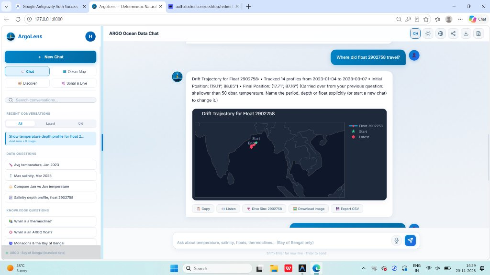
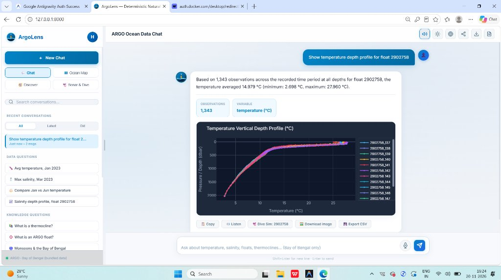
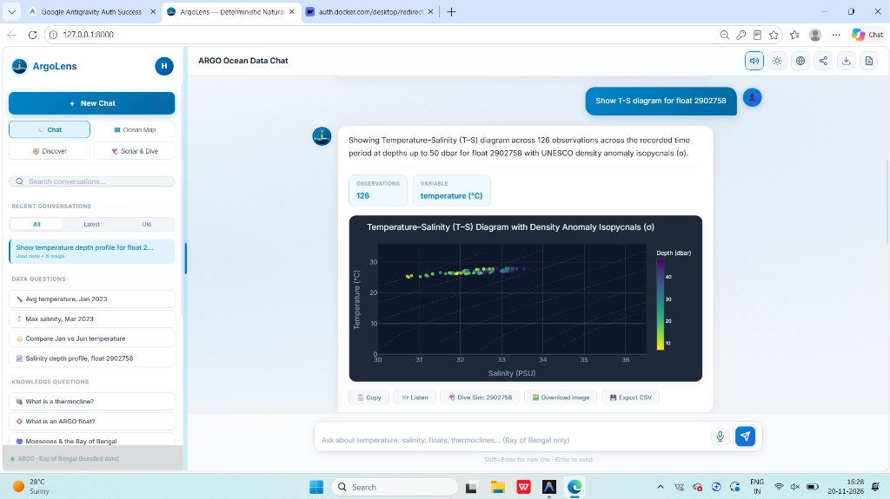
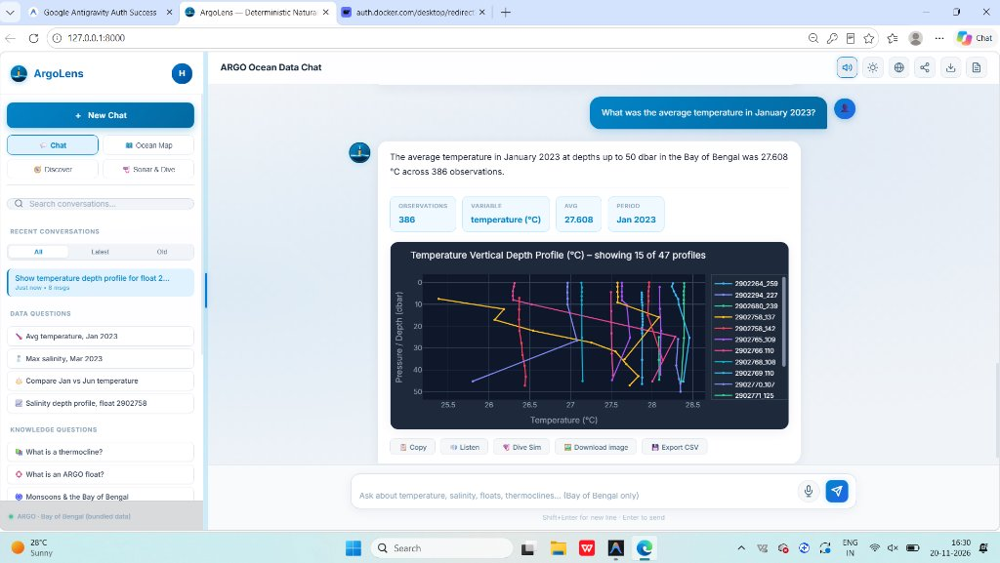
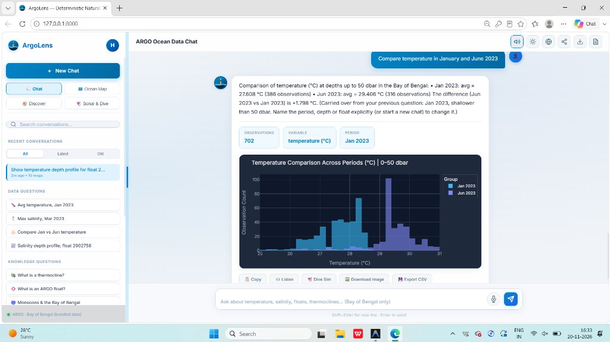

# ArgoLens: Natural Language Retrieval and Seawater Density Profiling for Autonomous ARGO Float Networks in the Bay of Bengal

**Kusheka K A**  
*Department of Computer Applications*  
*CMR Institute of Technology*  
*Bengaluru, India*  
*kusheka.mca25@cmrit.ac.in*  

**Likhith Charan R S**  
*Department of Computer Applications*  
*CMR Institute of Technology*  
*Bengaluru, India*  
*likhith.mca25@cmrit.ac.in*  

**Varsha Pawar**  
*Department of Computer Applications*  
*CMR Institute of Technology*  
*Bengaluru, India*  
*varshapawar1917@gmail.com*  

---

### Abstract
The global ARGO program deploys thousands of robotic floats that record vertical profiles of temperature, salinity, and pressure across the world ocean. Extracting useful answers from this data through natural language remains difficult, because off-the-shelf language models can invent sensor readings, ignore quality-control flags, and skip the nonlinear physics needed to compute density or mixed-layer depth. This paper describes ArgoLens, a query system designed for ARGO floats in the Bay of Bengal. It pairs a rule-driven intent parser and question classifier with parameterised SQL retrieval, WMO quality-flag enforcement, and UNESCO EOS-80 seawater-density computation. A lightweight TF-IDF retrieval layer handles conceptual questions with cited sources. We tested ArgoLens on 1,441 profiles from 38 floats collected between January 2023 and December 2024. A benchmark of 294 hand-written queries showed that the deterministic pipeline answered 237 correctly (80.61 percent) with zero runtime errors, at an average latency of 88 ms. Seasonal analysis revealed a winter median barrier-layer thickness of 20.1 dbar, consistent with the well-known freshwater-driven stratification of the Bay of Bengal.

### Index Terms
ARGO floats, natural language interface, Text-to-SQL, quality control, UNESCO EOS-80, seawater density, barrier layer thickness, mixed layer depth, Bay of Bengal.

---

## I. INTRODUCTION

The ARGO array today consists of roughly four thousand autonomous floats that cycle between the surface and depths of about two thousand metres, transmitting temperature and salinity profiles via satellite [1]. These observations have transformed our understanding of ocean heat storage, freshwater budgets, and large-scale circulation. In the Bay of Bengal, heavy monsoon rainfall and discharge from rivers like the Ganges and Brahmaputra create a thin, low-salinity cap over the surface layer [2]. Beneath this halocline, the isothermal layer often extends much deeper than the density-defined mixed layer, producing a barrier layer that insulates the warm surface from the cold thermocline and modulates the intensity of tropical cyclones passing overhead [3].

Despite this wealth of data, getting a straightforward answer from ARGO profiles still demands familiarity with NetCDF formats, data-centre APIs, and scientific programming. Natural language interfaces built on large language models offer a convenient shortcut [4], yet they carry three well-documented risks for oceanographic work. First, they can fabricate float identifiers, geographic regions, or sensor values. Second, raw float data frequently contain spikes, sensor drift, and missing readings; any aggregate computed without honouring the standard WMO quality flags can be severely misleading [6]. Third, quantities such as density anomaly, mixed-layer depth, and barrier-layer thickness depend on evaluating nonlinear equations of state along the vertical, something that token-level prediction simply cannot guarantee [9].

ArgoLens addresses these gaps through a rule-first, database-deterministic architecture. Its main contributions are:

1. A deterministic intent parser with geographic and variable guards that refuses unsupported parameters rather than silently substituting another variable.
2. Parameterised SQL retrieval with mandatory QC-flag filtering and an automatic surface-depth ceiling for aggregation queries.
3. Pure-Python implementations of the UNESCO EOS-80 density equation [9], Saunders pressure-to-depth conversion [10], and Mackenzie sound-speed formula [11], used to derive density, mixed-layer depth, barrier-layer thickness, and heuristic water-mass labels.
4. A TF-IDF retrieval layer for conceptual questions, an interactive web front-end, and an evaluation on 1,441 Bay of Bengal profiles with a 294-query benchmark.

The rest of the paper is laid out as follows. Section II surveys related work. Section III describes the data, the processing pipeline, and the thermodynamic computations. Section IV presents results and discusses limitations. Section V concludes the paper.

---

## II. LITERATURE REVIEW

Natural language access to structured data has advanced rapidly. Yu et al. [4] introduced Spider, a large cross-domain benchmark for semantic parsing to SQL, which became the de facto evaluation standard. Despite high scores on Spider, Ganti et al. [5] demonstrated that real-world customer queries cause accuracy to drop by roughly thirty percentage points, owing to long schemas, vague wording, and multi-step reasoning.

In the ocean domain, Raja et al. [13] presented FloatChat, a conversational interface for Argo data in the Indian Ocean, reporting high retrieval accuracy. Their system, however, does not describe QC-flag handling or seawater-density computation. Quality control is a cornerstone of trustworthy ocean data. Bushnell [6] detailed the QARTOD initiative, which provides variable-specific manuals and standardised flag conventions for real-time QC of oceanographic observations. Ono et al. [7] went further by modelling Argo QC as a sequential-labelling task using Conditional Random Fields, achieving a recall of 0.976 on 1,904 North Pacific profiles compared with 0.570 for the operational real-time system.

For marine data visualisation, He et al. [8] built a service-oriented architecture coupling GIS servers and UDDI registries to display Argo float tracks and sea-surface temperature on the web. The global Argo programme itself was reviewed by Riser et al. [1], who summarised fifteen years of observations and outlined the array's contributions to climate science.

The oceanographic context for this work is well established. Vinayachandran et al. [2] documented the formation of a salinity-controlled barrier layer in the Bay of Bengal during the summer monsoon. Neetu et al. [3] showed how that stratification limits the sea-surface cooling induced by tropical cyclones. The thermodynamic foundations rest on the UNESCO 1983 equation of state [9], Saunders' pressure-depth conversion [10], Mackenzie's sound-speed equation [11], and the mixed-layer criteria of de Boyer Montegut et al. [12].

No prior system combines deterministic natural-language retrieval, Argo QC-flag-aware filtering, and UNESCO EOS-80 density computation for ARGO data in the Bay of Bengal. ArgoLens fills that gap.

---

## III. METHODOLOGY

ArgoLens consists of a data-curation step followed by four processing stages (Fig. 1): guard and intent parsing (A), parameterised SQL retrieval with QC filtering (B), seawater thermodynamics (C), and output generation (D).

```
+--------------------------------------------------------------------------+
|                     USER NATURAL LANGUAGE QUERY                          |
|   "Show salinity depth profile and barrier layer for float 2902758"      |
+--------------------------------------------------------------------------+
                                    |
                                    v
+--------------------------------------------------------------------------+
| STAGE A: INTENT PARSER AND ENTITY GUARD                                  |
|  - Geographic boundary check (out-of-region coordinates rejected)        |
|  - Rule-first lexical parser (regex + domain dictionary)                 |
|  - Question classifier (data / knowledge / off-topic routing)            |
+--------------------------------------------------------------------------+
                                    |
                                    v
+--------------------------------------------------------------------------+
| STAGE B: DETERMINISTIC SQL GENERATION AND WMO QC FILTERING               |
|  - Parameterised SQLite queries (no string concatenation)                |
|  - Mandatory QC filter: temp_qc and sal_qc IN (1, 2, 5, 8) or NULL      |
|  - Surface guard: caps aggregation queries at p <= 50 dbar               |
+--------------------------------------------------------------------------+
                                    |
                                    v
+--------------------------------------------------------------------------+
| STAGE C: SEAWATER THERMODYNAMICS (UNESCO EOS-80)                         |
|  - Depth from pressure: Saunders (1981)                                  |
|  - Density anomaly: UNESCO EOS-80 sigma(S, T, 0)                        |
|  - MLD_T (delta_T = 0.2 C), MLD_rho (delta_sigma = 0.03 kg/m3)         |
|  - BLT = max(0, MLD_T - MLD_rho)                                        |
+--------------------------------------------------------------------------+
                                    |
                                    v
+--------------------------------------------------------------------------+
| STAGE D: VISUALISATION AND DETERMINISTIC SUMMARY                         |
|  - Plotly charts: T-S diagrams, vertical profiles, drift maps            |
|  - Text summary grounded strictly in returned SQL tuples                 |
+--------------------------------------------------------------------------+
```
*Fig. 1. ArgoLens processing pipeline.*

### A. Data Acquisition and Curation
Profiles were downloaded through the Argovis REST API for a Bay of Bengal bounding box (5-20 N, 80-95 E) covering January 2023 to December 2024. The data reside in a SQLite database with a profiles table (platform number, timestamp, latitude, longitude) and a measurements table (pressure, temperature, salinity, and their QC flags), indexed on profile identifier, pressure, time, and position. The final database contains 1,441 profiles from 38 floats (37 with valid measurements) and 151,555 measurement rows spanning 5.00-19.11 N and 80.07-91.93 E. During curation, 111 rows with negative pressure were dropped, and 2 salinity values below 20 PSU were nullified. Temperature and salinity are absent (QC flag 9) in about 27 percent of rows. Only flags 1 (good) and 9 (missing) appear in this partition.

### B. Guard and Intent Parsing
Every incoming question first passes through a typo corrector and a geographic guard that rejects named out-of-basin entities such as the Arabian Sea or the Pacific Ocean. A deterministic classifier then routes the input to a data handler, a knowledge handler (retrieval-augmented), or an off-topic responder. Data questions are parsed by a rule-based engine that maps regular expressions and domain dictionaries to eight task classes (depth profile, time series, map, summary, distribution, comparison, trajectory, and coverage), a target variable, spatial and temporal bounds, and an optional float identifier. Variables that the database does not hold, such as dissolved oxygen or pH, are explicitly refused and never silently mapped to temperature.

Spatial requests that ask for float movements are routed to trajectory generation. As shown in Fig. 4, when the user inquires about float displacement, the system extracts the platform identifier, fetches ordered coordinates across all dive cycles, and displays the progressive drift path.

  
*Fig. 4. Visual interface response for geographic trajectory inquiry ("Where did float 2902758 travel?"), charting 14 consecutive surfacing positions from 19.11°N, 88.65°E to 17.71°N, 87.16°E.*

### C. Parameterised SQL Retrieval and QC Enforcement
All queries use bound parameters and allow-listed column names. Quality-control filtering enforces WMO flag sets {1, 2, 5, 8}, accepting good, probably good, adjusted, and interpolated values plus NULL for unflagged legacy records. For single-variable aggregations, only the relevant flag column is restricted. For full vertical profiles and hydrographic analyses, both temperature and salinity flags are enforced:

```sql
SELECT m.pressure, m.temperature, m.salinity, p.lat, p.lon, p.timestamp
FROM measurements m
JOIN profiles p ON m.profile_id = p.id
WHERE p.platform = :platform
  AND (m.temp_qc IS NULL OR m.temp_qc IN (1, 2, 5, 8))
  AND (m.sal_qc IS NULL OR m.sal_qc IN (1, 2, 5, 8))
  AND m.pressure IS NOT NULL
ORDER BY m.pressure ASC;
```

When querying vertical hydrography for a designated float, the system extracts all valid cycle profiles down to 2,000 dbar. Fig. 2 illustrates the resulting vertical temperature profile for float 2902758 across multiple dives, exhibiting the sharp upper-layer thermocline and deep-water convergence towards 2.7 °C.

  
*Fig. 2. Vertical temperature profiles for ARGO float 2902758 retrieved by ArgoLens ("Show temperature depth profile for float 2902758"), summarizing 1,343 observations across cycles 137 to 147.*

For surface aggregation queries (for instance, average temperature in 2023), a ceiling of p <= 50 dbar is applied automatically so that deep-ocean values do not distort near-surface statistics.

### D. Seawater Thermodynamics
Density anomaly is computed using the UNESCO 1983 equation of state [9] at atmospheric pressure, taking in-situ temperature T (degrees C) and practical salinity S (PSU):

$$\rho_w = 999.842594 + 6.793952\times 10^{-2}T - 9.095290\times 10^{-3}T^2 + 1.001685\times 10^{-4}T^3 - 1.120083\times 10^{-6}T^4 + 6.536332\times 10^{-9}T^5 \tag{1}$$

$$\rho(S, T, 0) = \rho_w + S\left[A(T) + B(T)S^{1/2} + C \cdot S\right] \tag{2}$$

where A, B, and C are polynomial coefficients given in [9]. The density anomaly is $\sigma = \rho(S, T, 0) - 1000$ kg/m3. Depth z (m) is obtained from pressure p (dbar) and latitude with the Saunders formulation [10], and sound speed is evaluated with Mackenzie's nine-term equation [11].

Evaluating density across observation levels allows the generation of Temperature-Salinity (T-S) diagrams overlaid with density isopycnals (Fig. 3). This enables oceanographers to inspect water-mass mixing lines and stability directly within the chat interface.

  
*Fig. 3. Temperature-Salinity (T-S) diagram generated for float 2902758 ("Show T-S diagram for float 2902758") with UNESCO EOS-80 density anomaly isopycnal contours ($\sigma$) and color-coded observation depth.*

Mixed-layer depths and barrier-layer thickness follow the thresholds proposed by de Boyer Montegut et al. [12]. A profile qualifies only when it has a valid temperature-salinity pair at p <= 15 dbar; the reference level is the nearest valid observation to 10 dbar among levels with p <= 30 dbar. The thermal and density criteria are:

$$T(\text{MLD}_T) = T(p_{\text{ref}}) - 0.2\,^{\circ}\text{C} \tag{3}$$

$$\sigma(\text{MLD}_\rho) = \sigma(p_{\text{ref}}) + 0.03\text{ kg/m}^3 \tag{4}$$

$$\text{BLT} = \max\left(0,\, \text{MLD}_T - \text{MLD}_\rho\right) \tag{5}$$

Each observation level is also labelled with one of six heuristic Northern Indian Ocean water-mass classes based on its temperature, salinity, and pressure (Table VII).

### E. Knowledge Retrieval Layer
Conceptual questions (for example, "what is a thermocline?") are answered from a curated corpus of eight Markdown documents covering ARGO basics, ocean layers, Bay of Bengal monsoons, chart reading, and data quality. A TF-IDF index ranks individual sections, and answers are assembled from deterministic templates with source citations.

### F. Visualisation and Web Application
A FastAPI backend serves a browser front-end that renders Plotly charts (temperature-salinity diagrams, multi-trace vertical profiles, maps, and float drift tracks) alongside a text summary grounded strictly in the returned database tuples. The application also provides user accounts with Argon2 password hashing, per-IP rate limiting, result export, and PDF report generation.

---

## IV. RESULTS AND DISCUSSION

### A. Parser Benchmark
The parser was tested on a hand-written benchmark of 294 queries across eight categories. A query passes when the parsed task class and target variable match the annotation; for invalid or unsupported queries, the system must refuse or flag the input. Two configurations were tested offline with the language-model fallback disabled.

#### TABLE I: Parser Benchmark (N = 294)
| Configuration | Passed | Pass Rate | Violations | Mean Parse Time |
| :--- | :---: | :---: | :---: | :---: |
| **Rules only** | 214 / 294 | 72.79% | 10 (3.40%) | 0.32 ms |
| **Rules + classifier** | **237 / 294** | **80.61%** | **10 (3.40%)** | **0.32 ms** |

The classifier recovered 23 additional queries, mainly in float identification and unsupported-request categories. The ten variable-substitution violations arose when invalid queries contained a temperature or salinity keyword before the application-level guard could intervene.

#### TABLE II: Pass Counts by Category
| Category | N | Rules Only | Rules + Classifier |
| :--- | :---: | :---: | :---: |
| **Temperature aggregation** | 40 | 40 | 40 |
| **Salinity** | 40 | 40 | 40 |
| **Pressure and depth** | 35 | 35 | 35 |
| **Geographical filters** | 47 | 47 | 47 |
| **Seasonal and monsoon** | 37 | 24 | 24 |
| **Float identification** | 35 | 14 | 28 |
| **Invalid or unsupported** | 35 | 7 | 16 |
| **Conversational follow-ups** | 25 | 7 | 7 |
| **Total** | **294** | **214** | **237** |

All 294 queries also ran through the HTTP API without a single SQL or runtime error; 32 of 35 unsupported queries were correctly refused. A separate gold-standard suite of 15 cases passed 15 of 15. Fig. 6 displays the execution of a gold-standard baseline aggregation: the query calculates the mean surface temperature in January 2023 at depths up to 50 dbar, returning exactly 27.608 °C across 386 verified observations.

  
*Fig. 6. End-to-end response for temporal aggregation query ("What was the average temperature in January 2023?"), showing deterministic text synthesis (27.608 °C from 386 observations) and 0–50 dbar profile overlay.*

Furthermore, comparative inquiries across distinct calendar periods are evaluated deterministically. As depicted in Fig. 5, a user comparing January and June 2023 receives a side-by-side binned distribution showing a seasonal surface warming of +1.798 °C (rising from 27.608 °C to 29.406 °C).

  
*Fig. 5. Automated period comparison ("Compare temperature in January and June 2023"), presenting the temperature distribution histogram across 0–50 dbar and highlighting the +1.798 °C summer warming.*

### B. Latency

#### TABLE III: End-to-End API Latency (294 Queries)
| Metric | Value |
| :--- | :---: |
| **Mean** | **88.0 ms** |
| **Median** | **68.0 ms** |
| **P95** | **252.0 ms** |
| **P99** | **586.0 ms** |

#### TABLE IV: Internal Stage Latency (250 Repetitions, 5 Queries)
| Stage | Mean (ms) | Median (ms) | P95 (ms) |
| :--- | :---: | :---: | :---: |
| **Intent parsing** | 0.32 | 0.30 | 0.50 |
| **SQL retrieval + QC** | 123.52 | 84.40 | 301.03 |
| **Thermodynamics** | 0.62 | 0.56 | 0.95 |
| **Total** | **124.46** | **85.38** | **302.05** |

Database retrieval accounts for about 99 percent of internal time. Parsing and thermodynamic computation together take under one millisecond.

### C. QC Filtering Demonstration
Because this partition contains only flags 1 and 9, QC filtering was demonstrated on a synthetic four-level profile containing a 150 C spike (flag 4) and a 5.0 PSU salinity drift (flag 3). Without filtering, mean temperature was 58.60 C versus 28.13 C after filtering (108 percent divergence); mean salinity was 26.75 PSU versus 34.00 PSU (21 percent divergence).

### D. Retrieval-Augmented Answers

#### TABLE V: Retrieval Metrics (10 Conceptual Queries)
| Metric | Score |
| :--- | :---: |
| **Precision at 1** | **100.0%** |
| **Precision at 3** | **71.7%** |
| **Recall at 3** | **90.0%** |
| **MRR** | **1.000** |
| **Answer Grounding** | **93.3%** |
| **Citation Provenance** | **100.0%** |

### E. Seasonal Hydrography
Of 1,441 profiles, 93 lack a valid near-surface temperature-salinity pair and one summer profile never reached the density threshold, leaving 1,347 usable profiles (Table VI).

#### TABLE VI: Seasonal Medians (1,441 Profiles, 2023-2024)
| Parameter | Spring (MAM) | Summer (JJAS) | Post-Monsoon (ON) | Winter (DJF) |
| :--- | :---: | :---: | :---: | :---: |
| **Profiles (usable/total)** | 296 / 318 | 418 / 449 | 288 / 307 | 345 / 367 |
| **SST (C)** | 30.4 | 29.4 | 29.6 | 28.4 |
| **SSS (PSU)** | 32.9 | 33.3 | 33.2 | 33.0 |
| **MLD density (dbar)** | 11.3 | 18.9 | 11.4 | 15.3 |
| **MLD thermal (dbar)** | 15.5 | 28.4 | 22.3 | 41.2 |
| **BLT (dbar)** | **3.0** | **5.9** | **7.8** | **20.1** |
| **BLT IQR (dbar)** | 1.7-8.0 | 2.0-13.9 | 3.5-15.4 | 7.9-35.1 |

Sea-surface temperature peaks in spring (30.4 C) and dips in winter (28.4 C). The barrier layer is thinnest in spring (3.0 dbar) and thickest in winter (20.1 dbar), when the isothermal layer deepens to 41.2 dbar while the density mixed layer remains at 15.3 dbar. This pattern is consistent with published observations of freshwater-driven stratification in the Bay of Bengal [2].

#### TABLE VII: Water-Mass Classes (110,079 Levels)
| Class | Criteria | Levels | % |
| :--- | :--- | :---: | :---: |
| **Indian Deep/Bottom Water** | T < 10 C, p >= 800 dbar | 49,991 | 45.4 |
| **Indian Central Water** | 10 <= T < 20 C, 34.5 <= S <= 35.2 | 26,355 | 23.9 |
| **Transitional** | none of the other classes | 24,139 | 21.9 |
| **Bay of Bengal Surface** | T >= 27 C, S < 33.5 | 7,310 | 6.6 |
| **Equatorial Surface** | 24 <= T < 28 C, 33.5 <= S <= 34.6 | 2,080 | 1.9 |
| **Arabian Sea High Salinity** | T >= 25 C, S >= 35.0 | 204 | 0.2 |

### F. Limitations
1. The benchmark was written by the authors and checked on two reference cases only.
2. The language-model fallback was disabled throughout; no comparison with an unconstrained model is claimed.
3. Only QC flags 1 and 9 appear in the data, so flag handling for 2, 5, and 8 is implemented but not exercised.
4. Density uses in-situ rather than potential temperature, introducing a small error at depth.
5. The dataset covers only two years and should not be treated as a climatology.

---

## V. CONCLUSIONS

This paper presented ArgoLens, a deterministic natural-language query system for ARGO float data in the Bay of Bengal. By coupling rule-based parsing, parameterised SQL with QC enforcement, and UNESCO EOS-80 thermodynamic computation, it sidesteps the principal failure modes of general-purpose language models: variable substitution, ignored quality flags, and skipped physics. On 1,441 profiles the system answered 237 of 294 benchmark queries correctly (80.61 percent) at an average latency of 88 ms, and reproduced the expected seasonal cycle of barrier-layer thickness, with a winter median of 20.1 dbar. A TF-IDF retrieval layer supplied cited answers to conceptual questions.

Future work will extend the parser grammar to handle follow-up questions and float identification more robustly, benchmark the optional LLM fallback against the deterministic pipeline on an independently annotated query set, migrate the equation of state to TEOS-10, expand the archive to multiple years and ocean basins, and evaluate the system with practising oceanographers.

---

## VI. REFERENCES

[1] S. C. Riser et al., "Fifteen years of ocean observations with the global Argo array," *Nature Climate Change*, vol. 6, no. 2, pp. 145-153, 2016, doi: 10.1038/nclimate2872.

[2] P. N. Vinayachandran, V. S. N. Murty, and V. Ramesh Babu, "Observations of barrier layer formation in the Bay of Bengal during summer monsoon," *J. Geophys. Res. Oceans*, vol. 107, no. C12, pp. SRF 19-1 to SRF 19-9, 2002, doi: 10.1029/2001JC000831.

[3] S. Neetu, M. Lengaigne, E. M. Vincent, J. Vialard, K. G. Lamb, and G. Samson, "Influence of upper-ocean stratification on tropical cyclone-induced surface cooling in the Bay of Bengal," *J. Geophys. Res. Oceans*, vol. 117, no. C12, p. C12020, 2012, doi: 10.1029/2012JC008433.

[4] Y. Yu, C. Zhang, J. Wang, and H. Wang, "Spider: A large-scale human-labeled dataset for complex and cross-domain semantic parsing and text-to-SQL," in *Proc. 56th Annu. Meeting Assoc. Comput. Linguistics (ACL)*, Melbourne, Australia, 2018, pp. 3911-3921, doi: 10.18653/v1/P18-1033.

[5] M. Ganti, L. Orr, and S. Wu, "Evaluating Text-to-SQL model failures on real-world data," in *Proc. 2024 IEEE 40th Int. Conf. Data Eng. (ICDE)*, Utrecht, Netherlands, 2024, p. 5654, doi: 10.1109/ICDE60146.2024.00456.

[6] M. Bushnell, "Quality assurance/quality control of real-time oceanographic data: Status and implementation efforts," in *Proc. OCEANS 2015 - MTS/IEEE Washington*, Washington, DC, USA, 2015, pp. 1-5, doi: 10.1109/OCEANS.2015.7404555.

[7] S. Ono, H. Matsuyama, K. Fukui, and S. Hosoda, "Error detection of oceanic observation data using sequential labeling," in *Proc. 2015 IEEE Int. Conf. Data Sci. Adv. Analytics (DSAA)*, Paris, France, 2015, pp. 1-8, doi: 10.1109/DSAA.2015.7344896.

[8] Y. He, F. Su, Y. Du, and R. Xiao, "Web-based visualization of marine environment data," in *Proc. 18th Int. Conf. Geoinformatics*, Beijing, China, 2010, pp. 1-6, doi: 10.1109/GEOINFORMATICS.2010.5567751.

[9] UNESCO, "Algorithms for computation of fundamental properties of seawater," *UNESCO Tech. Papers Marine Sci.*, vol. 44, pp. 1-53, 1983.

[10] P. M. Saunders, "Practical conversion of pressure to depth," *J. Phys. Oceanogr.*, vol. 11, no. 4, pp. 573-574, 1981, doi: 10.1175/1520-0485(1981)011<0573:PCOPTD>2.0.CO;2.

[11] K. V. Mackenzie, "Nine-term equation for sound speed in the oceans," *J. Acoust. Soc. Amer.*, vol. 70, no. 3, pp. 807-812, 1981, doi: 10.1121/1.386919.

[12] C. de Boyer Montegut, G. Madec, A. S. Fischer, A. Lazar, and D. Iudicone, "Mixed layer depth over the global ocean: An examination of profile data and a profile-based climatology," *J. Geophys. Res. Oceans*, vol. 109, no. C12, p. C12003, 2004, doi: 10.1029/2004JC002378.

[13] S. Raja, A. P. Janani, D. Deepak, and R. Nithish, "FloatChat - AI-powered conversational interface for ocean data discovery and visualization," in *Proc. 2025 10th Int. Conf. Smart Struct. Syst. (ICSSS)*, Chennai, India, 2025, doi: 10.1109/ICSSS66939.2025.11346110.
