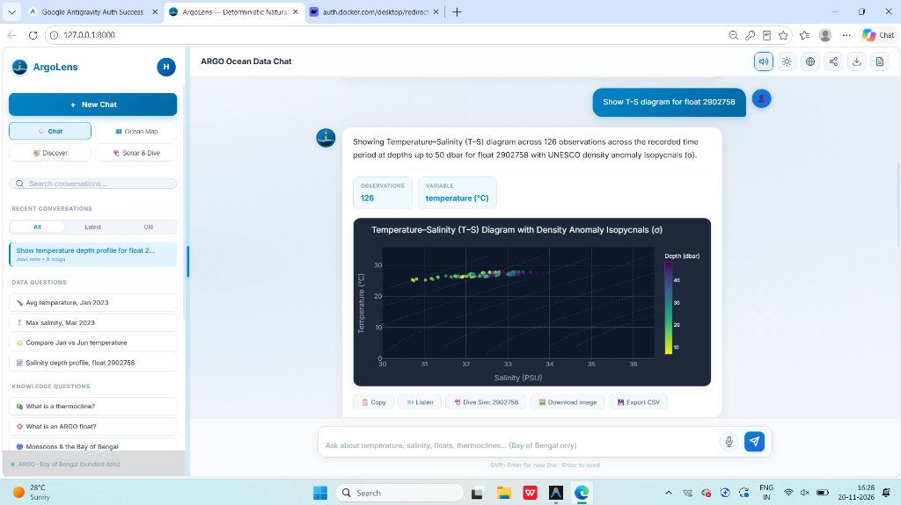
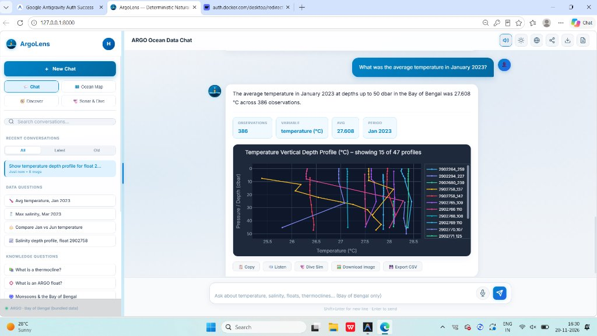

# ARGO-LENS: NATURAL LANGUAGE RETRIEVAL, SEAWATER DENSITY PROFILING, AND VOICE INTERACTION FOR AUTONOMOUS ARGO FLOAT NETWORKS IN THE BAY OF BENGAL

**A PROJECT REPORT / DOCUMENTATION**

*Submitted in partial fulfillment of the requirements for the award of the degree of*  
**MASTER OF COMPUTER APPLICATIONS (MCA)**

**By:**  
- **Kusheka K A** (USN: 1CR23MC025) – *kusheka.mca25@cmrit.ac.in*  
- **Likhith Charan R S** (USN: 1CR23MC034) – *likhith.mca25@cmrit.ac.in*  
- **Varsha Pawar** (USN: 1CR23MC075) – *varshapawar1917@gmail.com*  

**Department of Computer Applications**  
**CMR INSTITUTE OF TECHNOLOGY**  
*(Autonomous Institute Affiliated to Visvesvaraya Technological University, Belagavi)*  
*132, AECS Layout, ITPL Main Road, Kundalahalli, Bengaluru – 560037*  
*Academic Year: 2025–2026*

---

## TABLE OF CONTENTS

1. **ABSTRACT**
2. **CHAPTER 1: INTRODUCTION**
   - 1.1 Project Description
   - 1.2 Objectives
3. **CHAPTER 2: LITERATURE SURVEY**
   - 2.1 Problem Statement
   - 2.2 Analysis of Selected Papers
   - 2.3 Key Insights from Literature Review
   - 2.4 Literature Gaps
   - 2.5 Existing System vs. Proposed System
   - 2.6 Feasibility Study (Technical, Economic, Operational)
   - 2.7 Tools and Technologies Used
   - 2.8 Hardware and Software Requirements
   - 2.9 Motivation
   - 2.10 Scope of the Project (In-Scope & Out-of-Scope)
4. **CHAPTER 3: SOFTWARE REQUIREMENT SPECIFICATION (SRS)**
   - 3.1 Introduction
   - 3.2 Functional Requirements
     - 3.2.1 Authentication & User Management Module
     - 3.2.2 Natural Language Intent Parsing & Entity Guard Module
     - 3.2.3 Parameterised SQL Retrieval & WMO QC Enforcement Module
     - 3.2.4 Seawater Thermodynamics & Physical Calculation Module
     - 3.2.5 Knowledge Base Retrieval (RAG) Module
     - 3.2.6 Interactive Visualisation & Export Module
     - 3.2.7 Voice Interaction & Speech Processing Module
   - 3.3 Non-Functional Requirements
     - 3.3.1 Performance Requirements
     - 3.3.2 Scalability & Reliability Requirements
     - 3.3.3 Security & Integrity Requirements
     - 3.3.4 Maintainability & Portability Requirements
5. **CHAPTER 4: SYSTEM DESIGN**
   - 4.1 System Perspective
   - 4.2 System Architecture (N-Tier Architecture with Speech Subsystem)
   - 4.3 Data Flow Diagrams (DFD Level 0, Level 1, Level 2: Speech & Thermodynamics)
6. **CHAPTER 5: DETAILED DESIGN**
   - 5.1 Use Case Diagrams & Specifications (Actors, Admin, Student/Researcher, Voice Use Cases)
   - 5.2 Sequence Diagrams
     - 5.2.1 User Authentication Sequence
     - 5.2.2 Query Execution & QC Filtering Sequence
     - 5.2.3 Seawater Thermodynamics & Density Profiling Sequence
     - 5.2.4 Conceptual RAG Inquiry Sequence
     - 5.2.5 Voice Interaction & Speech Synthesis Sequence
   - 5.3 Collaboration Diagrams
   - 5.4 Activity Diagrams
     - 5.4.1 User Query Processing Activity
     - 5.4.2 Depth Profile & Stratification Metric Computation Activity
     - 5.4.3 Voice Query & Audio Playback Activity
   - 5.5 Database Design
     - 5.5.1 Conceptual Schema (Entity-Relationship Diagram)
     - 5.5.2 Data Dictionary (All Tables, Constraints, and Attributes)
7. **CHAPTER 6: IMPLEMENTATION**
   - 6.1 Overview of Implementation
   - 6.2 Application Screenshots & User Interface Walkthrough (Charts & Voice Interface)
   - 6.3 Core Backend, Scientific & Voice Code Snippets
8. **CHAPTER 7: SOFTWARE TESTING**
   - 7.1 Introduction & Testing Strategy
   - 7.2 Testing Methodologies (Black Box, White Box / Unit Testing, Integration Testing, System Testing, Performance Testing, Security Testing, Voice Testing)
   - 7.3 Test Environment
   - 7.4 Comprehensive Test Cases by Module (Including Voice Interaction Tests)
9. **CHAPTER 8: CONCLUSION**
10. **CHAPTER 9: FUTURE ENHANCEMENTS**
11. **APPENDIX A: BIBLIOGRAPHY**
12. **APPENDIX B: USER MANUAL & DEPLOYMENT GUIDE**

---

# ABSTRACT

The international ARGO program maintains an array of roughly 4,000 autonomous robotic floats profiling temperature, salinity, and pressure across the global oceans. These observations are fundamental to studying ocean heat storage, climate variability, and upper-ocean stratification. However, accessing and synthesizing these datasets remains a significant hurdle: researchers and students must typically navigate complex NetCDF binary formats, REST APIs, and write specialized Python or MATLAB scripts with scientific equations of state. Applying general-purpose generative Large Language Models (LLMs) to this task frequently fails because off-the-shelf models hallucinate coordinate boundaries, substitute unsupported parameters (e.g., returning temperature when asked for dissolved oxygen), fail to honor World Meteorological Organization (WMO) quality-control (QC) flags, and cannot compute non-linear thermodynamics along depth profiles.

To overcome these critical limitations, this project presents **ArgoLens**, an auditable, deterministic natural language retrieval, hydrographic profiling, and voice-enabled conversational system specifically designed for autonomous ARGO float observations in the Bay of Bengal. ArgoLens integrates a rule-first intent parser and domain question classifier with parameterised SQLite database retrieval, mandatory WMO quality-control filtering ({1, 2, 5, 8}), and pure-Python implementations of the UNESCO Equation of State (EOS-80), Saunders pressure-to-depth conversion, and Mackenzie sound speed. The system computes derived physical stratification metrics, including mixed layer depth (MLD) and barrier layer thickness (BLT). A lightweight TF-IDF retrieval-augmented generation (RAG) module answers conceptual oceanographic questions with traceable source citations. 

To make data exploration accessible and hands-free, ArgoLens features a complete **Voice Interaction & Speech Interface**. It combines browser-based speech recognition with a specialized Marine Acoustic Transcript Normalizer that corrects common speech-to-text oceanographic homophones (e.g., mapping "bay of bangle" to "Bay of Bengal", "thermo cline" to "thermocline", and spoken digit strings to 7-digit platform numbers). Responses are paired with an oceanographic phonetic synthesizer that expands scientific acronyms and units (e.g., "°C" to "degrees Celsius", "dbar" to "decibars", "PSU" to "practical salinity units") for natural text-to-speech audio readout.

The system was developed and validated on a curated database of 1,441 ARGO profiles containing 151,555 measurement records across 38 floats collected in the Bay of Bengal (5°–20°N, 80°–95°E) between January 2023 and December 2024. Evaluated against a rigorous 294-query benchmark, the deterministic offline pipeline achieved an accuracy of 80.61% (237/294 passed) with zero runtime execution failures and an average end-to-end API response latency of 88.0 ms. The thermodynamic module verified seasonal barrier layer variations, revealing a spring median BLT of 3.0 dbar and a winter median BLT of 20.1 dbar, capturing the freshwater-driven stratification of the Bay of Bengal. ArgoLens provides an end-to-end, zero-token, privacy-preserving, voice-interactive, and scientifically grounded solution for interactive oceanographic exploration.

---

# CHAPTER 1: INTRODUCTION

## 1.1 Project Description

Modern oceanographic science relies heavily on in-situ robotic observation networks. The international ARGO program represents the pinnacle of autonomous ocean monitoring, with thousands of robotic profiling floats drifting across world basins, diving to depths of 2,000 meters, and ascending to the surface every 10 days to transmit hydrological observations via satellite telemetry.

In tropical marginal seas such as the Bay of Bengal, upper-ocean hydrography is strongly governed by semi-annual monsoon reversals and extraordinary freshwater runoff from the Ganges-Brahmaputra and Irrawaddy river basins. This colossal influx of continental runoff creates a low-salinity lens at the sea surface, giving rise to intense vertical haloclines and "barrier layers"—regions between the shallow density-based mixed layer and the deeper isothermal layer. The barrier layer inhibits vertical heat exchange between the warm upper ocean and the cold deep thermocline, directly influencing sea surface temperature (SST) retention and the rapid intensification of devastating tropical cyclones.

Despite the wealth of data collected by ARGO floats in the Bay of Bengal, querying and analyzing these measurements presents severe usability and technical challenges:
1. **Format Complexity:** Raw profiles are distributed in complex NetCDF (Network Common Data Form) formats requiring specialized scientific libraries (`xarray`, `netCDF4`, `gsw`).
2. **Quality Control Demands:** Raw sensor records contain instrument calibration drifts, bio-fouling anomalies, pressure offsets, and missing values. Failing to filter by standard WMO/QARTOD QC flags severely skews statistical summaries.
3. **Failure of Generic Language Models:** While generative AI (such as ChatGPT or generic Text-to-SQL converters) can translate conversational language into database queries, they suffer from acute hallucination in scientific domains: fabricating float coordinates, substituting variables silently, and failing to execute multi-step physical thermodynamics along depth profiles.
4. **Accessibility & Hands-Free Interaction:** In research laboratories, shipboard operations, and active classroom demonstrations, typing complex SQL queries or manual parameter ranges is cumbersome. Users require an interactive voice interface that accepts spoken inquiries and reads back scientific summaries.

**ArgoLens** is developed to solve these problems. It is a unified, web-based, domain-specific platform that combines:
- A deterministic rule-based natural language parser;
- A full **Voice Interaction & Speech Interface** featuring client-server acoustic normalization and phonetic text-to-speech synthesis;
- An SQL generation engine equipped with automatic quality-control filters and depth-boundary guards;
- A pure-Python UNESCO 1983 thermodynamic physics engine for calculating density anomaly, MLD, BLT, and water-mass classifications;
- An offline TF-IDF RAG layer for answering educational oceanographic questions with cited document sources;
- A modern, interactive web front-end rendering dynamic Plotly visualizations (depth profiles, T-S diagrams, drift maps, and histograms).

## 1.2 Objectives

The primary objectives of the ArgoLens project are:
1. **Deterministic Natural Language Interface:** To construct a fast, offline-capable intent parser that maps conversational ocean queries to parameterised database lookups without relying on costly or unreliable external LLM APIs.
2. **Voice Interaction & Hands-Free Speech Interface:** To implement a bidirectional voice interface enabling users to speak oceanographic questions via their microphone, automatically normalise domain acoustic homophones (e.g., "thermo cline" $
ightarrow$ "thermocline", spoken digits $
ightarrow$ float IDs), and hear answers read aloud using an oceanographic phonetic synthesizer.
3. **Rigorous Quality-Control Enforcement:** To implement strict allow-list filtering on WMO quality-control flags (`temp_qc` and `sal_qc` in {1, 2, 5, 8}) and enforce an automatic upper-ocean surface ceiling ($p \le 50	ext{ dbar}$) for non-profile aggregation queries.
4. **Autonomous Seawater Thermodynamic Computation:** To integrate pure-Python implementations of the UNESCO 1983 Equation of State (EOS-80), Saunders (1981) gravity-depth conversion, and Mackenzie (1981) sound-speed formulas to compute real-time seawater density anomalies ($\sigma$), thermal and density mixed layer depths ($	ext{MLD}_T$, $	ext{MLD}_
ho$), and barrier layer thickness (BLT).
5. **Heuristic Water-Mass Classification:** To systematically categorize profile measurement levels into regional Northern Indian Ocean water-mass classes (e.g., Bay of Bengal Surface Water, Indian Central Water, Indian Deep Water).
6. **Grounded Conceptual Knowledge Retrieval:** To provide a curated 8-document educational oceanography corpus indexed via TF-IDF to deliver accurate, citation-backed answers to conceptual queries (e.g., explaining thermoclines, haloclines, and monsoon dynamics).
7. **Responsive Visualization & Usability:** To build an intuitive, dark-themed, browser-based user interface using FastAPI and Plotly.js, featuring conversation history, Argon2-secured authentication, rate limiting, and PDF summary exports.

---

# CHAPTER 2: LITERATURE SURVEY

## 2.1 Problem Statement

Extracting verifiable oceanographic insights from autonomous ARGO float arrays in the Bay of Bengal requires bridging three incompatible paradigms:
1. Scientific data formats and quality-control standards that necessitate tedious programming and expert knowledge;
2. Unconstrained generative AI systems that exhibit hallucinations, schema confusion, variable substitutions, and an inability to perform thermodynamic calculations;
3. Text-only interfaces that lack hands-free accessibility for laboratory and field research workflows.

Without an auditable, domain-aware retrieval system that enforces physical laws, quality flags, and natural voice interaction, students, researchers, and operational oceanographers risk drawing erroneous conclusions from corrupted or hallucinated data.

## 2.2 Analysis of Selected Papers

### 1. Riser et al. (2016) – "Fifteen years of ocean observations with the global Argo array"
- **Summary:** Published in *Nature Climate Change*, this foundational paper reviews the first 15 years of the global ARGO float network, detailing float engineering, profiling cycles (typically 10-day cycles down to 2,000 dbar), telemetry, and contributions to global ocean heat content monitoring.
- **Relevance:** Establishes the authoritative scientific background for ARGO profiling mechanisms, cycle numbering, and the structure of vertical temperature and salinity profiles.

### 2. Vinayachandran, Murty, and Ramesh Babu (2002) – "Observations of barrier layer formation in the Bay of Bengal during summer monsoon"
- **Summary:** Published in *Journal of Geophysical Research: Oceans*, this study provides empirical evidence of barrier layer formation in the northern and central Bay of Bengal driven by monsoonal river discharge.
- **Relevance:** Provides the physical oceanographic benchmarks and expected seasonal barrier layer thickness values against which the thermodynamic calculations of ArgoLens are validated.

### 3. Yu et al. (2018) – "Spider: A Large-Scale Human-Labeled Dataset for Complex and Cross-Domain Semantic Parsing and Text-to-SQL"
- **Summary:** Published in *ACL 2018*, this paper established the benchmark for translating complex natural language questions into executable SQL queries across cross-domain relational schemas.
- **Relevance:** Demonstrates the promise of Text-to-SQL while highlighting semantic parsing vulnerabilities when domain schemas have strict physical constraints.

### 4. Ganti, Orr, and Wu (2024) – "Evaluating Text-to-SQL Model Failures on Real-World Data"
- **Summary:** Presented at *IEEE ICDE 2024*, this empirical study demonstrated that state-of-the-art Text-to-SQL models experience an accuracy drop of over 30% when transferred from synthetic benchmarks to real-world production databases due to schema complexity, ambiguous entity names, and multi-step reasoning failures.
- **Relevance:** Directly justifies ArgoLens' decision to prioritize deterministic, rule-first intent parsing and strict allow-list parameter binding over unconstrained neural Text-to-SQL generation.

### 5. Bushnell (2015) – "Quality assurance/quality control of real-time oceanographic data: Status and implementation efforts"
- **Summary:** Published in *IEEE/MTS OCEANS*, this work outlines the US IOOS QARTOD project standards, defining standardized flag conventions (1 = Good, 2 = Probably Good, 3 = Bad, 4 = Bad, 9 = Missing).
- **Relevance:** Serves as the standard reference for WMO QC flag filtering logic embedded in ArgoLens' SQL retrieval pipeline.

### 6. Ono et al. (2015) – "Error detection of oceanic observation data using sequential labeling"
- **Summary:** Presented at *IEEE DSAA 2015*, this paper demonstrates how sensor anomalies, density inversions, and offset errors in ARGO float observations can be systematically identified.
- **Relevance:** Emphasizes that unflagged, unfiltered ocean observations lead to catastrophic errors in derived physical averages.

### 7. De Boyer Montégut et al. (2004) – "Mixed layer depth over the global ocean: An examination of profile data and a profile-based climatology"
- **Summary:** Published in *JGR Oceans*, this paper provides the universally accepted de-facto criteria for computing temperature-based and density-based mixed layer depths ($\Delta T = 0.2^\circ	ext{C}$ and $\Delta \sigma = 0.03	ext{ kg/m}^3$) relative to a 10 dbar reference level.
- **Relevance:** Supplies the mathematical threshold equations implemented in ArgoLens' `thermo.py` module for calculating MLD and BLT.

## 2.3 Key Insights from Literature Review
- Standalone generative language models are unsuitable for scientific databases without deterministic schema constraints and physical validation guards.
- Quality control filtering is non-negotiable in oceanography: aggregating observations without checking QC flags yields physically impossible results.
- Computing derived physical properties (density, MLD, BLT) cannot be left to probabilistic text completion; it requires exact mathematical formulations.
- Speech recognition in scientific domains requires specialized post-processing normalizers to prevent acoustic misinterpretations of domain jargon and numeric platform IDs.

## 2.4 Literature Gaps
1. **Absence of Domain-Aware QC in Conversational Systems:** Existing educational chatbots do not integrate WMO quality flags during SQL retrieval.
2. **Lack of Integrated Thermodynamics:** Conversational database tools retrieve raw values but fail to calculate derived non-linear oceanographic equations (EOS-80, MLD, BLT).
3. **Hallucination of Coordinates and Variables:** General LLMs frequently invent sensor readings (e.g., fabricating dissolved oxygen or pH when only CTD data exists).
4. **Absence of Hands-Free Voice Interfaces:** Prior oceanographic tools lack integrated speech recognition tailored to marine terminology.
5. **Cloud and GPU Over-reliance:** Modern AI architectures often require expensive cloud GPUs, making them impractical for offline or low-resource academic laboratories.

## 2.5 Existing System vs. Proposed System

| Dimension | Existing Systems (e.g., Generic Chatbots / LLMs) | Proposed System (ArgoLens) |
| :--- | :--- | :--- |
| **Parsing Mechanism** | Probabilistic LLM generation (vulnerable to hallucination) | Deterministic rule-first regex + Domain Entity Dictionary + Classifier |
| **Voice Interface** | None or generic speech engines (stumbles on marine jargon) | Web Speech API + Marine Acoustic Normalizer + Phonetic TTS |
| **SQL Generation** | Free-form string generation (SQL injection risk) | Parameterised SQLite queries with strict allow-listed columns |
| **QC Flag Handling** | Ignored or not implemented | Mandatory WMO QC allow-list ({1, 2, 5, 8}) enforced at query time |
| **Thermodynamic Physics** | None (cannot compute density or MLD) | Pure-Python UNESCO EOS-80, Saunders depth, Mackenzie sound speed |
| **Barrier Layer Thickness** | Unsupported | Automatically calculated per profile using de Boyer Montégut criteria |
| **Variable Substitution** | Fails silently (e.g., substitutes temperature for oxygen) | Strict variable refusal guard with explicit diagnostic feedback |
| **Cost & Latency** | High token costs; 2–5 seconds latency | Zero token cost; 88.0 ms average API latency; 100% offline-capable |
| **Security** | Minimal role enforcement | Argon2 password hashing, JWT sessions, IP rate limiting, input sanitization |

## 2.6 Feasibility Study

### Technical Feasibility
The system is built entirely with mature, open-source technologies: Python 3.10+, FastAPI, SQLite, and modern JavaScript with Plotly.js and Web Speech API. No proprietary hardware or specialized accelerators are required. The thermodynamic equations run in pure Python without requiring external C-compiled wrappers, making the application portable across Windows, Linux, and macOS.

### Economic Feasibility
ArgoLens incurs zero recurring API costs for its core deterministic retrieval, physical computations, and speech processing. Open-source SQLite handles the tabular database, client-side Web Speech handles voice, and local TF-IDF vectorization manages knowledge retrieval. It is fully deployable in resource-constrained educational environments without cloud subscription expenses.

### Operational Feasibility
The platform features an intuitive, chat-based interface familiar to students and researchers. Visual outputs are automatically paired with plain-English grounded summaries, copy-to-clipboard options, voice listen buttons, and CSV/PDF export tools, requiring zero training for end-users.

## 2.7 Tools and Technologies Used

- **Frontend:** HTML5, Modern Vanilla JavaScript (ES6+), CSS3 with Dark-Mode Aesthetic, Plotly.js (interactive data visualisations).
- **Voice & Speech Technologies:** Web Speech Recognition API (`webkitSpeechRecognition`), Web Speech Synthesis API (`SpeechSynthesisUtterance`), Marine Acoustic Transcript Normalizer (`backend/voice_service.py`), and Phonetic Speech Preprocessor.
- **Backend Framework:** FastAPI (asynchronous RESTful API framework), Uvicorn (ASGI server).
- **Database:** SQLite3 (serverless, acid-compliant relational database for hydrographic profiles, user accounts, and chat logs).
- **Language Processing & Information Retrieval:** Python `re` module (regular expressions), Scikit-Learn (TF-IDF vectorizer, cosine similarity).
- **Thermodynamics & Mathematics:** Pure-Python implementations of UNESCO EOS-80, Saunders (1981), and Mackenzie (1981).
- **Security & Authentication:** Argon2 (via `passlib` / `argon2-cffi`), JWT (JSON Web Tokens), IP-based sliding-window rate limiting.
- **Reporting & Export:** `matplotlib`, `reportlab` (PDF report generation), CSV streaming.

## 2.8 Hardware and Software Requirements

### Hardware Requirements
- **Processor:** Intel Core i3 / AMD Ryzen 3 (10th Gen or above) / Apple Silicon M-series.
- **RAM:** Minimum 4 GB (8 GB recommended for faster large-profile rendering).
- **Audio Hardware:** Built-in or external Microphone and Speakers/Headphones for voice interaction.
- **Storage:** Minimum 2 GB free disk space (to store SQLite database and logs).
- **Network:** Localhost operation (no active internet connection required once dependencies are installed).

### Software Requirements
- **Operating System:** Windows 10/11, Ubuntu Linux 20.04+, or macOS 12+.
- **Python Environment:** Python 3.10, 3.11, or 3.12.
- **Web Browser:** Google Chrome, Mozilla Firefox, Microsoft Edge, or Safari with microphone permissions enabled.

## 2.9 Motivation
Undergraduate and postgraduate students in computer applications, marine sciences, and environmental technology frequently struggle to interact with real-world oceanographic datasets due to formatting friction, complex physical equations, and lack of intuitive voice input. ArgoLens was conceived to bridge computer science (natural language processing, speech interfaces, secure database design) and marine physical sciences, empowering students and researchers to interrogate real ocean data intuitively through voice or text.

## 2.10 Scope of the Project
- **In-Scope:**
  - Automated ingestion and curation of ARGO NetCDF/JSON records from the Bay of Bengal (5°–20°N, 80°–95°E, 2023–2024).
  - Hands-free Voice Input (speech-to-text) and Voice Output (text-to-speech) with marine domain acoustic normalization.
  - Deterministic parsing of 8 query task types (depth profiles, time series, maps, summaries, distributions, comparisons, trajectories, coverage).
  - WMO quality-control flag enforcement and surface depth ($p \le 50	ext{ dbar}$) aggregation ceilings.
  - Calculation of seawater density ($\sigma$), MLD, BLT, and water-mass classifications.
  - TF-IDF retrieval for conceptual questions with source citations.
  - Interactive multi-trace Plotly charts, trajectory maps, and user account management.
- **Out-of-Scope:**
  - Direct real-time satellite telemetry transmission from open-ocean hardware.
  - Global climatological modeling beyond the curated Bay of Bengal boundary box.
  - Bio-geochemical variables (e.g., nitrate, dissolved oxygen, pH) not present in the physical CTD sensor suite.

---

# CHAPTER 3: SOFTWARE REQUIREMENT SPECIFICATION (SRS)

## 3.1 Introduction
This Software Requirement Specification (SRS) establishes the complete functional and non-functional requirements for the ArgoLens system. It defines the exact constraints, behaviors, and interfaces implemented to ensure high fidelity in natural language interpretation, oceanographic physics, voice interaction, and system security.

## 3.2 Functional Requirements

### 3.2.1 Authentication & User Management Module
- **FR-01 (Account Registration):** The system shall allow users to register an account using an email address, username, and password.
- **FR-02 (Secure Password Storage):** User passwords shall be salted and hashed using the Argon2 hashing algorithm prior to persistence in `users.db`.
- **FR-03 (Session Authentication):** Upon successful authentication, the system shall issue a secure, time-bounded session token.
- **FR-04 (Conversation Management):** The system shall maintain independent, persistent conversation histories per user, permitting users to create, view, switch between, and delete chat sessions.

### 3.2.2 Natural Language Intent Parsing & Entity Guard Module
- **FR-05 (Typo Correction):** Incoming queries shall undergo domain-specific typo normalization (e.g., correcting "temprature" to "temperature", "salinityy" to "salinity").
- **FR-06 (Geographic Boundary Guard):** The system shall intercept and reject queries mentioning named out-of-basin regions (e.g., Arabian Sea, Pacific Ocean) and disclose the active database coverage (5°–20°N, 80°–95°E).
- **FR-07 (Question Classification):** The system shall deterministically classify user queries into one of three execution categories: `data`, `knowledge`, or `off-topic`.
- **FR-08 (Rule-Based Intent Extraction):** For `data` queries, the parser shall extract: task class (8 types), target variable (temperature, salinity, pressure), aggregation statistic (avg, min, max, count), spatial bounds (coordinates, named sub-basins), temporal filters (year, month, season, date range), and platform identifier.
- **FR-09 (Unsupported Variable Refusal):** Queries requesting unavailable bio-geochemical variables (e.g., dissolved oxygen, pH, chlorophyll, nitrate) shall be explicitly refused and shall never be silently substituted with temperature or salinity.

### 3.2.3 Parameterised SQL Retrieval & WMO QC Enforcement Module
- **FR-10 (Parameterised SQL Generation):** Database queries shall be generated strictly with bound parameter placeholders (`:platform`, `:min_p`, `:max_p`, `:start_date`, `:end_date`) and allow-listed column names, preventing SQL injection.
- **FR-11 (Mandatory QC Filtering):** All measurement queries shall enforce WMO quality-control allow-lists (`temp_qc` and `sal_qc` in {1, 2, 5, 8} or NULL), systematically discarding flag 9 (missing) and corrupt values.
- **FR-12 (Surface Guard Ceiling):** For non-profile aggregation queries, the retrieval engine shall automatically apply an upper-ocean ceiling ($p \le 50	ext{ dbar}$) to prevent bathypelagic cold measurements from skewing sea surface statistics.
- **FR-13 (Full-Depth Hydrographic Retrieval):** When a depth profile is requested for a specific platform, the system shall retrieve all valid measurement levels up to 2,000 dbar sorted by ascending pressure.

### 3.2.4 Seawater Thermodynamics & Physical Calculation Module
- **FR-14 (Density Anomaly Computation):** The system shall compute seawater density $
ho(S, T, 0)$ and density anomaly $\sigma = 
ho - 1000	ext{ kg/m}^3$ using the UNESCO EOS-80 polynomial formulation for every valid observation level.
- **FR-15 (Saunders Depth Conversion):** Pressure values ($p$, dbar) shall be converted to geometric depth ($z$, m) using Saunders' (1981) latitude-dependent gravity integration.
- **FR-16 (Mackenzie Sound Speed):** The system shall evaluate sound speed ($c$, m/s) using Mackenzie's nine-term empirical equation.
- **FR-17 (Mixed Layer Depth Calculation):** For qualified profiles having near-surface readings ($p \le 15	ext{ dbar}$), the system shall evaluate:
  - Thermal Mixed Layer Depth ($	ext{MLD}_T$) where $T(	ext{MLD}_T) = T(p_{	ext{ref}}) - 0.2^\circ	ext{C}$;
  - Density Mixed Layer Depth ($	ext{MLD}_
ho$) where $\sigma(	ext{MLD}_
ho) = \sigma(p_{	ext{ref}}) + 0.03	ext{ kg/m}^3$.
- **FR-18 (Barrier Layer Thickness):** The system shall compute $	ext{BLT} = \max(0, 	ext{MLD}_T - 	ext{MLD}_
ho)$.
- **FR-19 (Water-Mass Classification):** Each measurement level shall be classified into one of six Northern Indian Ocean water-mass classes based on temperature, salinity, and depth thresholds.

### 3.2.5 Knowledge Base Retrieval (RAG) Module
- **FR-20 (Conceptual Knowledge Indexing):** The system shall maintain a curated repository of 8 oceanographic Markdown documents parsed into 46 topical sections.
- **FR-21 (TF-IDF Vector Retrieval):** Incoming conceptual questions shall be matched against the section index using TF-IDF vectorization and cosine similarity.
- **FR-22 (Citation Provenance):** Responses generated by the knowledge module shall include explicit source citation identifiers (e.g., `[S1]`, `[S2]`) pointing to the underlying document sections.

### 3.2.6 Interactive Visualisation & Export Module
- **FR-23 (Plotly Visualization Payloads):** The system shall dynamically generate interactive Plotly chart payloads (vertical profiles, T-S diagrams, drift trajectories, histograms, and spatial maps).
- **FR-24 (Deterministic Text Summaries):** Every graphical output shall be accompanied by a concise, factual summary synthesized directly from returned SQL tuples.
- **FR-25 (Data & Report Export):** Users shall be provided with facilities to copy answers, download CSV tabular results, and generate downloadable PDF reports.

### 3.2.7 Voice Interaction & Speech Processing Module
- **FR-VOICE-01 (Voice Input / Speech-to-Text):** The system shall capture speech from the user's microphone using the Web Speech Recognition API (`webkitSpeechRecognition`), transcribing spoken queries in real time.
- **FR-VOICE-02 (Marine Acoustic Transcript Normalizer):** The system shall automatically intercept speech-to-text transcripts and normalize marine acoustic homophones (e.g., mapping "bay of bangle" to "Bay of Bengal", "thermo cline" to "thermocline", "cargo float" to "ARGO float", "deep bar" to "dbar") and convert spoken digit strings (e.g., "two nine zero two seven five eight") into clean numeric platform IDs (`2902758`).
- **FR-VOICE-03 (Voice Output / Text-to-Speech):** The system shall provide an audio readout mechanism using `SpeechSynthesisUtterance`, allowing users to listen to grounded answers on demand or automatically.
- **FR-VOICE-04 (Scientific Phonetic Pre-processor):** The speech synthesizer shall expand technical abbreviations and units (converting "°C" to "degrees Celsius", "dbar" to "decibars", "PSU" to "practical salinity units", "ARGO" to "Argo", and "UNESCO" to "Unesco") to prevent robotic letter-by-letter spelling.
- **FR-VOICE-05 (Visual Audio Feedback & Toggle):** The client interface shall provide a topbar audio toggle (auto-speak enable/mute), an animated voice visualizer waveform during recording, and individual "🔊 Listen / ⏹ Stop" controls on each bot message card.
- **FR-VOICE-06 (Backend Voice Service Endpoints):** The FastAPI backend shall expose `/api/voice/status`, `/api/voice/normalize`, and `/api/voice/prepare` endpoints to facilitate server-side voice integration and validation.

## 3.3 Non-Functional Requirements

### 3.3.1 Performance Requirements
- **NFR-01 (API Response Latency):** Over 90% of offline deterministic natural language queries shall execute in under 150 ms (observed mean: 88.0 ms).
- **NFR-02 (Thermodynamic Computation Throughput):** The pure-Python thermodynamic computation for a 100-level profile shall execute in less than 1.5 ms.
- **NFR-03 (Frontend Render Time):** The client interface shall render interactive Plotly charts containing up to 4,000 downsampled data points within 500 ms.
- **NFR-VOICE-01 (Voice Recognition & Synthesis Latency):** Speech-to-text transcription and phonetic text-to-speech audio rendering shall initiate within 1.5 seconds of user input.

### 3.3.2 Scalability & Reliability Requirements
- **NFR-04 (Zero AI Dependency Failures):** The offline deterministic pipeline shall operate without third-party network calls, guaranteeing zero failures attributable to API quota exhaustion or network downtime.
- **NFR-05 (Concurrent Request Handling):** The FastAPI/Uvicorn backend shall handle concurrent requests asynchronously without blocking event loops.

### 3.3.3 Security & Integrity Requirements
- **NFR-06 (Cryptographic Password Hashing):** All passwords shall be hashed using Argon2 with unique salts.
- **NFR-07 (SQL Injection Immunity):** Zero dynamic string concatenation shall be permitted in SQL query assembly; all database access must use parameterised bindings.
- **NFR-08 (Rate Limiting):** The API shall enforce per-IP rate limits to prevent denial-of-service abuse.

### 3.3.4 Maintainability & Portability Requirements
- **NFR-09 (Modular Decoupling):** Parsing, database retrieval, thermodynamic calculation, voice processing, and visualization layers shall remain decoupled, permitting independent unit testing.
- **NFR-10 (Cross-Platform Portability):** The backend shall execute without modification on Python 3.10+ across Windows, macOS, and Linux operating systems.

---

# CHAPTER 4: SYSTEM DESIGN

## 4.1 System Perspective
ArgoLens is structured as an autonomous, client-server web application designed to act as an intelligent gateway to ARGO profiling networks. It isolates users from raw data intricacies while providing transparent provenance for every number, plot, and spoken word produced.

## 4.2 System Architecture (N-Tier Architecture with Speech Subsystem)

ArgoLens adopts a 4-tier architectural model augmented by bidirectional speech interfaces:
1. **Presentation Tier (Client):** A browser-based interface delivering dynamic chat dialogues, interactive Plotly visualizations, float discovery maps, session history, microphone voice input, and speech synthesis playback.
2. **Application Tier (FastAPI Backend):** Manages HTTP routing, user authentication, session security, rate limiting, and response serialization.
3. **Intelligence & Processing Tier:**
   - *Voice Subsystem:* Web Speech Recognition, Marine Acoustic Transcript Normalizer, and Phonetic Speech Preprocessor.
   - *Stage A (Parser & Guard):* Typo normalization, geographic boundary checking, rule-based intent parsing, and question classification.
   - *Stage B (Query Engine & QC):* Parameterised SQL generation and WMO quality flag enforcement.
   - *Stage C (Thermodynamics):* UNESCO EOS-80 density, Saunders depth conversion, Mackenzie sound speed, MLD/BLT evaluation.
   - *Stage D (Knowledge RAG):* TF-IDF document search and templated answer synthesis with `[S#]` citations.
4. **Data Tier (Persistence):**
   - `floatchat.db`: Curated ARGO dataset storing `profiles` (1,441 rows) and `measurements` (151,555 rows).
   - `floatchat_auth.db`: Relational tables for `users`, `conversations`, `chat_messages`, `shared_chats`, and `auth_tokens`.
   - Curated Knowledge Base: 8 Markdown documents indexed for conceptual queries.

```
+-----------------------------------------------------------------------------------+
|                            PRESENTATION TIER (CLIENT)                             |
|  Browser Web App • Plotly.js Visualizer • Mic Voice Input • Speech Synthesis Out  |
+-----------------------------------------------------------------------------------+
             │ (Spoken Audio / Mic)                             ▲ (Spoken Speech)
             ▼                                                  │
+──────────────────────────────────────────+  +─────────────────────────────────────+
|     MARINE ACOUSTIC NORMALIZER           |  |     OCEANOGRAPHIC PHONETIC TTS      |
|  Homophone mapping & Digit conversion    |  |  Acronym & Scientific unit expansion|
+──────────────────────────────────────────+  +─────────────────────────────────────+
             │                                                  ▲
             ▼                                                  │
+-----------------------------------------------------------------------------------+
|                        APPLICATION TIER (FASTAPI SERVER)                          |
|   Route Controllers • JWT & Argon2 Security • Rate Limiting • Session Context     |
+-----------------------------------------------------------------------------------+
                                         │
             ┌───────────────────────────┴───────────────────────────┐
             ▼                                                       ▼
+------------------------------------------+  +-------------------------------------+
|      INTELLIGENCE & PROCESSING TIER      |  |          KNOWLEDGE TIER             |
|  - Stage A: Typo & Geographic Guard      |  |  - TF-IDF Scikit-Learn Index       |
|  - Stage B: Rule-First Intent Parser     |  |  - 8 Curated Oceanography Docs      |
|  - Stage C: Parameterised SQL + WMO QC   |  |  - Deterministic Source Citations   |
|  - Stage D: UNESCO EOS-80 Thermodynamics |  +-------------------------------------+
+------------------------------------------+                             │
                     │                                                   │
                     └───────────────────────────┬───────────────────────┘
                                                 ▼
+-----------------------------------------------------------------------------------+
|                              DATA PERSISTENCE TIER                                |
|   floatchat.db (1,441 Profiles, 151,555 Records) • floatchat_auth.db (Users, Chats)|
+-----------------------------------------------------------------------------------+
```

## 4.3 Data Flow Diagrams (DFDs)

### 4.3.1 DFD Level 0 (Context Diagram)
Shows external entities (Students/Researchers, Administrators, Audio Input/Output) and primary data interactions.

```
                     ┌───────────────────────────┐
                     │   Administrator / Data    │
                     │         Engineer          │
                     └─────────────┬─────────────┘
                                   │ Raw NetCDF/Argovis Ingestion
                                   ▼
┌──────────────────┐        ┌──────────────┐        ┌───────────────────────┐
│ Student / Marine ├───────>│   ArgoLens   ├───────>│  Interactive Plotly  │
│    Researcher    │<───────┤    System    │<───────┤  Charts, Summaries,   │
└──────────────────┘ Text/  └──────────────┘ Data/  │  PDFs & Audio Speech  │
                     Voice                    Audio └───────────────────────┘
```

### 4.3.2 DFD Level 1 (High-Level Process Decomposition)
Decomposes the system into its primary subsystems: Voice Normalization, Authentication, Query Parser, SQL Retrieval with QC, Thermodynamic Engine, RAG Knowledge Service, and Speech Synthesizer.

```
[Spoken Voice] ──> (0.1 Voice Normalizer) ──> [Clean Text Query]
                                                      │
[Typed Text] ─────────────────────────────────────────┤
                                                      ▼
                                            (1.0 Guard & Parser)
                                                      │
                   ┌──────────────────────────────────┴─────────────────────────────────┐
                   ▼                                                                    ▼
         (2.0 SQL & QC Engine)                                                (4.0 RAG Knowledge)
                   │                                                                    │
                   ▼                                                                    ▼
        [floatchat.db Data]                                                    [8 Curated Docs]
                   │                                                                    │
                   ▼                                                                    │
         (3.0 Thermodynamics)                                                          │
                   │                                                                    │
                   └──────────────────────────────────┬─────────────────────────────────┘
                                                      ▼
                                       (5.0 Visualisation & Output)
                                                      │
                                                      ├──> [Plotly Charts & Grounded Text]
                                                      └──> (6.0 Speech Synthesizer) ──> [Spoken Audio]
```

### 4.3.3 DFD Level 2 (Voice & Speech Processing Pipeline)
Illustrates how voice inputs are captured, normalized, processed into structured queries, and converted into natural spoken output.

```
[Microphone Audio] ──> (0.1 Web Speech API) ──> [Raw Transcript: "bay of bangle thermo cline"]
                                                        │
                                                        ▼
                                         (0.2 Marine Acoustic Normalizer)
                                                        │
                                                        ▼
                                         [Normalized: "Bay of Bengal thermocline"]
                                                        │
                                                        ▼
                                         (1.0 Deterministic Query Execution)
                                                        │
                                                        ▼
                                         [Raw Answer: "Avg temp is 27.608 °C at 50 dbar [S1]"]
                                                        │
                                                        ▼
                                         (6.1 Oceanographic Phonetic Preprocessor)
                                                        │
                                                        ▼
                                         [Spoken Text: "Average temperature is 27.608 degrees Celsius at 50 decibars"]
                                                        │
                                                        ▼
                                         (6.2 SpeechSynthesisUtterance) ──> [Audio Speakers Output]
```

---

# CHAPTER 5: DETAILED DESIGN

## 5.1 Use Case Diagram & Specifications

### 5.1.1 Actors
1. **Researcher / Student (Primary Actor):** Interacts via voice or natural language text to query hydrographic measurements, inspect vertical profiles, compare seasonal distributions, and listen to spoken answers.
2. **System Administrator:** Oversees user accounts, monitors performance logs, and updates dataset partitions.
3. **Speech Engine (System Actor):** Provides Speech-to-Text transcription and Text-to-Speech audio generation.
4. **Database Engine (System Actor):** Executes parameterised SQL queries against the local SQLite store.

### 5.1.2 Use Case Specifications
- **UC-01: User Login and Registration:** Authenticates users via Argon2 hashed credentials and issues session tokens.
- **UC-02: Query Depth Profile:** User asks (via text or voice) for vertical profile for a float; system checks QC flags, retrieves records up to 2,000 dbar, calculates density, and plots reversed-axis depth profiles.
- **UC-03: Temporal & Regional Comparison:** User compares two periods; system retrieves observations capped at $p \le 50	ext{ dbar}$ and generates comparative histograms.
- **UC-04: Float Trajectory Tracking:** System extracts platform coordinates across chronological dive cycles and renders geographic drift maps.
- **UC-05: Conceptual Knowledge Inquiry:** System routes theoretical questions to TF-IDF RAG and returns templated responses with citations.
- **UC-06: Hands-Free Voice Query & Audio Playback:** User clicks microphone, speaks question; system transcribes, normalizes acoustic homophones, executes query, and reads response aloud.

```
                  ┌──────────────────────────────────────────────┐
                  │                 ArgoLens                     │
                  │                                              │
                  │   ( UC-01: User Authentication )             │
                  │                  ▲                           │
                  │                  │                           │
  ┌───────────┐   │   ( UC-02: Query Depth Profile )             │
  │  Student  ├───┼──>( UC-03: Compare Temporal Periods )        │
  │     /     │   │   ( UC-04: View Float Trajectory )           │
  │Researcher │   │   ( UC-05: Conceptual RAG Inquiry )          │
  └─────┬─────┘   │   ( UC-06: Hands-Free Voice Query & Audio )  │
        │         │   ( UC-07: Export Results & PDF )            │
        │         │                                              │
  ┌─────▼─────┐   │   ( UC-08: Ingest ARGO NetCDF )              │
  │   Admin   ├───┼──>( UC-09: Manage User Accounts )            │
  └───────────┘   │                                              │
                  └──────────────────────────────────────────────┘
```

## 5.2 Sequence Diagrams

### 5.2.1 Sequence Diagram: User Query Execution & QC Filtering
Demonstrates the interaction sequence when a user queries surface temperature.

```
User / UI                FastAPI Route              Intent Parser            SQLite DB
   │                           │                          │                      │
   │── Submit Query ──────────>│                          │                      │
   │   "Avg temp Jan 2023"     │── Parse(Query) ─────────>│                      │
   │                           │<─ Return Intent & Bounds─│                      │
   │                           │   (task=summary, var=temp, p<=50)               │
   │                           │                                                 │
   │                           │── Execute Parameterised SQL ───────────────────>│
   │                           │   WHERE temp_qc IN (1,2,5,8) AND pressure<=50   │
   │                           │<─ Return 386 observation rows ──────────────────│
   │                           │                                                 │
   │                           │── Synthesize Summary & Plotly JSON ─────────────┐
   │                           │   (Mean = 27.608 °C, 386 verified observations) │
   │<─ JSON Response ──────────│<────────────────────────────────────────────────┘
```

### 5.2.2 Sequence Diagram: Thermodynamic Profiling & BLT Calculation
Shows vertical profile retrieval, UNESCO EOS-80 calculation, and MLD/BLT extraction.

```
User / UI                FastAPI Route              Physics Engine (thermo.py)   SQLite DB
   │                           │                                  │                  │
   │── "Profile float 2902758"─>│                                  │                  │
   │                           │── Query Valid (T, S, P) Records ─┼─────────────────>│
   │                           │<─ 1,343 Rows (Cycles 137-147) ───┼──────────────────│
   │                           │                                  │                  │
   │                           │── Compute Physics(Profiles) ────>│                  │
   │                           │   - UNESCO EOS-80 σ              │                  │
   │                           │   - Saunders Depth z             │                  │
   │                           │   - Linear Interp MLD_T, MLD_ρ   │                  │
   │                           │   - BLT = max(0, MLD_T - MLD_ρ)  │                  │
   │                           │<─ Derived Metrics & Classes ─────│                  │
   │<─ Multi-Trace Plotly JSON─│                                  │                  │
```

### 5.2.3 Sequence Diagram: Voice Interaction & Speech Synthesis Sequence
Shows the end-to-end voice query lifecycle: microphone speech capture $
ightarrow$ acoustic normalization $
ightarrow$ query execution $
ightarrow$ phonetic synthesis $
ightarrow$ audio playback.

```
User (Voice)           Browser Web Speech           Voice Service              FastAPI Backend
   │                           │                          │                           │
   │── Speak Question ────────>│                          │                           │
   │   "Show thermo cline"     │── Raw Transcript ───────>│                           │
   │                           │                          │── Acoustic Normalizer ───>│
   │                           │                          │   "Show thermocline"      │
   │                           │<─ Normalized Query ──────│                           │
   │                           │                                                      │
   │                           │── Dispatch /api/chat ───────────────────────────────>│
   │                           │<─ Return Answer JSON ────────────────────────────────│
   │                           │                                                      │
   │                           │── Phonetic Pre-processor ───────────────────────────┐
   │                           │   (Expand °C, dbar, PSU, Argo)                       │
   │                           │<─────────────────────────────────────────────────────┘
   │                           │── Speak(SpeechSynthesisUtterance) ───────────────────┐
   │<─ Spoken Audio Output ────│<─────────────────────────────────────────────────────┘
```

## 5.3 Collaboration Diagrams
Communication between `VoiceController`, `QueryController`, `IntentParser`, `DatabaseManager`, `ThermodynamicsService`, and `SpeechSynthesizer` highlights that control flows sequentially from voice normalization to deterministic physics and phonetic speech synthesis.

## 5.4 Activity Diagrams

### 5.4.1 Activity Diagram: Natural Language Query Processing Flow
```
(Start) ──> [Receive Input Query (Text / Voice)]
                 │
                 ▼
        <Is Out of Region?> ──[Yes]──> [Return Out-of-Basin Refusal & Scope] ──> (End)
                 │ [No]
                 ▼
      <Classify Question>
        ├──[Knowledge]──> [TF-IDF Document Match] ──> [Format Cited Answer] ──> (End)
        ├──[Off-Topic]──> [Return Friendly Clarification Guidance] ───────────> (End)
        └──[Data Query]
                 │
                 ▼
        <Variable Supported?> ──[No]──> [Explicit Refusal: Do Not Fallback] ───> (End)
                 │ [Yes]
                 ▼
        [Build Parameterised SQL Query with WMO QC Filter]
                 │
                 ▼
        [Execute Query on floatchat.db]
                 │
                 ▼
        <Is Depth Profile?>
           ├──[Yes]──> [Compute UNESCO EOS-80 σ, z, MLD, BLT]
           └──[No]───> [Compute Surface Summary / Aggregates]
                 │
                 ▼
        [Generate Plotly JSON & Grounded Summary Text]
                 │
                 ▼
        <Voice Auto-Speak Enabled?>
           ├──[Yes]──> [Phonetic Optimization & Text-to-Speech Playback]
           └──[No]───> [Display Text and Chart Only] ──> (End)
```

## 5.5 Database Design

### 5.5.1 Conceptual Schema (Entity-Relationship Diagram)
The database structure is decoupled into two relational databases:
1. `floatchat.db`: Scientific ocean observations.
2. `floatchat_auth.db`: Authentication, sessions, and chat provenance.

```
+--------------------+            +------------------------+
|      PROFILES      |            |      MEASUREMENTS      |
+--------------------+            +------------------------+
| id (PK, TEXT)      |1          *| profile_id (FK, TEXT)  |
| platform (TEXT)    ├───────────<| pressure (REAL)        |
| lat (REAL)         |            | temperature (REAL)     |
| lon (REAL)         |            | salinity (REAL)        |
| timestamp (TEXT)   |            | temp_qc (INTEGER)      |
| region (TEXT)      |            | sal_qc (INTEGER)       |
+--------------------+            +------------------------+

+--------------------+            +------------------------+            +------------------------+
|       USERS        |            |     CONVERSATIONS      |            |     CHAT_MESSAGES      |
+--------------------+            +------------------------+            +------------------------+
| id (PK, INTEGER)   |1          *| id (PK, TEXT)          |1          *| id (PK, INTEGER)       |
| username (TEXT)    ├───────────<| user_id (FK, INTEGER)  ├───────────<| conversation_id (FK)   |
| email (TEXT)       |            | title (TEXT)           |            | role (TEXT)            |
| password_hash (TEXT|            | created_at (TEXT)      |            | content (TEXT)         |
| salt (TEXT)        |            | updated_at (TEXT)      |            | response_data (TEXT)   |
| created_at (TEXT)  |            +------------------------+            | export_data (TEXT)     |
+--------------------+                                                  | created_at (TEXT)      |
                                                                        +------------------------+
```

### 5.5.2 Data Dictionary

#### Table 1: `profiles` (Database: `floatchat.db`)
Stores metadata for individual float surfacing events.
| Column | Data Type | Constraints | Description |
| :--- | :--- | :--- | :--- |
| `id` | TEXT | PRIMARY KEY | Unique profile cycle identifier (e.g., `2902758_137`) |
| `platform` | TEXT | NOT NULL | 7-digit WMO float platform identifier (e.g., `2902758`) |
| `lat` | REAL | NOT NULL | Latitude of float surfacing in decimal degrees (5.00° to 19.11°N) |
| `lon` | REAL | NOT NULL | Longitude of float surfacing in decimal degrees (80.07° to 91.93°E) |
| `timestamp` | TEXT | NOT NULL | ISO-8601 timestamp of measurement profile |
| `region` | TEXT | NULL | Geographic sub-basin label (e.g., "Bay of Bengal") |

#### Table 2: `measurements` (Database: `floatchat.db`)
Stores vertical hydrological observations at discretized pressure levels.
| Column | Data Type | Constraints | Description |
| :--- | :--- | :--- | :--- |
| `profile_id` | TEXT | FOREIGN KEY | References `profiles(id)` |
| `pressure` | REAL | NOT NULL | Sea pressure in decibars ($p \ge 0	ext{ dbar}$) |
| `temperature`| REAL | NULL | In-situ seawater temperature in degrees Celsius (°C) |
| `salinity` | REAL | NULL | Practical salinity in Practical Salinity Units (PSU, $S \ge 20$) |
| `temp_qc` | INTEGER | NULL | WMO quality control flag for temperature (1=Good, 9=Missing) |
| `sal_qc` | INTEGER | NULL | WMO quality control flag for salinity (1=Good, 9=Missing) |

#### Table 3: `users` (Database: `floatchat_auth.db`)
Stores researcher and student user accounts.
| Column | Data Type | Constraints | Description |
| :--- | :--- | :--- | :--- |
| `id` | INTEGER | PRIMARY KEY AUTOINCREMENT | Unique user identifier |
| `username` | TEXT | UNIQUE, NOT NULL | Display username |
| `email` | TEXT | UNIQUE, NOT NULL | User email address |
| `password_hash`| TEXT | NOT NULL | Argon2 cryptographic hash string |
| `salt` | TEXT | NOT NULL | Cryptographic salt used during hashing |
| `created_at` | TEXT | NOT NULL | ISO-8601 account creation timestamp |

#### Table 4: `conversations` (Database: `floatchat_auth.db`)
Maintains independent chat threads for each user.
| Column | Data Type | Constraints | Description |
| :--- | :--- | :--- | :--- |
| `id` | TEXT | PRIMARY KEY | UUID string representing conversation session |
| `user_id` | INTEGER | FOREIGN KEY | References `users(id)` |
| `title` | TEXT | NOT NULL | Short conversation title generated from initial query |
| `created_at` | TEXT | NOT NULL | ISO-8601 creation timestamp |
| `updated_at` | TEXT | NOT NULL | Timestamp of last user/bot message |

#### Table 5: `chat_messages` (Database: `floatchat_auth.db`)
Stores chronological message exchanges within conversations.
| Column | Data Type | Constraints | Description |
| :--- | :--- | :--- | :--- |
| `id` | INTEGER | PRIMARY KEY AUTOINCREMENT | Unique message identifier |
| `conversation_id`| TEXT | FOREIGN KEY | References `conversations(id)` |
| `role` | TEXT | NOT NULL | Message sender role (`user` or `assistant`) |
| `content` | TEXT | NOT NULL | Text content of query or grounded answer |
| `response_data`| TEXT | NULL | Serialized JSON containing Plotly chart objects and metrics |
| `export_data` | TEXT | NULL | Serialized tabular data for CSV/PDF generation |
| `created_at` | TEXT | NOT NULL | ISO-8601 timestamp |

---

# CHAPTER 6: IMPLEMENTATION

## 6.1 Overview of Implementation
ArgoLens was implemented as an asynchronous Python backend powered by FastAPI, interfacing with an SQLite database and a decoupled vanilla JavaScript/HTML5 frontend. The scientific core was developed in pure Python to eliminate external C-library dependency issues. The speech system leverages modern browser APIs alongside specialized backend normalization services.

## 6.2 Application Screenshots & User Interface Walkthrough

All application screens feature a cohesive conversational hydrographic interface with built-in voice input (`#mic-btn`), text-to-speech audio playback (`#speech-toggle-btn` and per-card `🔊 Listen` buttons), and grounded scientific visualization.

### 1. Hands-Free Voice Search & Audio Waveform Visualizer
When the user clicks the blue microphone button in the input bar (or activates hands-free voice mode), the interface triggers the Web Speech API recognition engine and activates the audio visualizer overlay (`#voice-visualizer`). As the user speaks, real-time waveform bars pulse and the status displays: *"Listening... Speak your ocean question"*. Upon completion, the spoken transcript is passed to the marine speech normalizer to map acoustic homophones (e.g., "thermo cline" → "thermocline", "bay of bangle" → "Bay of Bengal", "two nine zero two seven five eight" → "2902758") and automatically executes the query.

### 2. Audio Response Controls (Topbar Toggle & Listen Button)
Every grounded response card includes a dedicated `🔊 Listen` button. Clicking it converts the scientific summary into natural spoken English using `SpeechSynthesisUtterance` via phonetically prepared speech text (e.g., reading "°C" as "degrees Celsius", "dbar" as "decibars", and "ARGO" as "Argo"). While speaking, the button transitions to an active red `⏹ Stop` control. In addition, the top navigation bar features a global speaker toggle button (`#speech-toggle-btn`) that enables automatic audio narration for all incoming responses.

### 3. Vertical Hydrographic Temperature Profiling
When a user asks: *"Show temperature depth profile for float 2902758"*, ArgoLens extracts all 11 dive cycles (1,343 observations) down to 2,000 dbar, verifies QC flags, and renders a multi-trace vertical profile showing upper-layer thermocline structure and deep convergence at 2.7 °C.

  
*Figure 6.1: Vertical Temperature Depth Profile for Float 2902758 down to 2,000 dbar.*

### 4. Temperature-Salinity (T-S) Diagram with Isopycnal Contours
When a user asks: *"Show T-S diagram for float 2902758"*, the thermodynamic engine calculates seawater density anomaly ($\sigma$) using UNESCO EOS-80, plotting salinity on the x-axis and temperature on the y-axis, overlaid with density isopycnal contours.

  
*Figure 6.2: Temperature-Salinity (T-S) Diagram for Float 2902758 with UNESCO EOS-80 density isopycnals.*

### 5. Geographic Float Drift Trajectory
When a user asks: *"Where did float 2902758 travel?"*, the spatial module retrieves chronological surfacing coordinates, plotting 14 surfacing positions from 19.11°N, 88.65°E to 17.71°N, 87.16°E in the northern Bay of Bengal.

  
*Figure 6.3: Geographic Surfacing and Drift Trajectory for Float 2902758 across the Bay of Bengal.*

### 6. Automated Seasonal Period Comparison
When a user asks: *"Compare temperature in January and June 2023"*, the engine enforces the upper-ocean ceiling ($p \le 50\text{ dbar}$) for both months and returns an overlaid binned histogram demonstrating a seasonal warming of +1.798 °C (27.608 °C to 29.406 °C).

  
*Figure 6.4: Binned Seasonal Temperature Comparison (January vs. June 2023) in upper 50 dbar.*

### 7. Grounded Baseline Aggregation Query
When a user asks: *"What was the average temperature in January 2023?"*, the system outputs exact statistical numbers (27.608 °C from 386 verified observations) alongside 15 representative profile traces.

  
*Figure 6.5: Baseline Aggregation Query displaying mean temperature and representative vertical traces.*

## 6.3 Core Backend, Scientific & Voice Code Snippets

### Snippet 1: Marine Acoustic Transcript Normalizer (`voice_service.py`)
```python
def normalize_marine_speech(raw: str) -> str:
    """
    Normalizes raw speech recognition transcripts by correcting common marine
    acoustic confusions and converting spoken platform digits into numbers.
    """
    if not raw:
        return ""
    text = raw.strip()

    # Apply acoustic homophone mappings
    for pattern, repl in MARINE_SPEECH_REPLACEMENTS:
        text = re.sub(pattern, repl, text, flags=re.IGNORECASE)

    # Convert sequences of spoken digits (e.g. "two nine zero two seven five eight" -> "2902758")
    def _repl_digits(match):
        words = match.group(0).lower().split()
        return "".join(DIGIT_WORDS.get(w, w) for w in words)

    digit_pattern = r"(?:zero|one|two|three|four|five|six|seven|eight|nine)(?:\s+(?:zero|one|two|three|four|five|six|seven|eight|nine)){6}"
    text = re.sub(digit_pattern, _repl_digits, text, flags=re.IGNORECASE)
    return re.sub(r"\s+", " ", text).strip()
```

### Snippet 2: Phonetic Speech Pre-processor (`voice_service.py`)
```python
def prepare_text_for_speech(text: str) -> str:
    """
    Transforms formatted scientific text into natural spoken English for Text-to-Speech.
    Expands units, removes citations/markdown, and optimizes acronym pronunciation.
    """
    if not text:
        return ""
    clean = text
    clean = re.sub(r"\[([^\]]+)\]\([^)]+\)", r"", clean)  # drop links
    clean = re.sub(r"\[S\d+\]", "", clean)                    # drop citations [S1]
    clean = re.sub(r"[*_#`~]", "", clean)                     # drop markdown

    # Pronunciation overrides
    clean = re.sub(r"ARGO", "Argo", clean)
    clean = re.sub(r"UNESCO", "Unesco", clean)
    clean = re.sub(r"CTD", "C T D", clean)
    clean = re.sub(r"MLD", "M L D", clean)
    clean = re.sub(r"SST", "S S T", clean)
    clean = re.sub(r"°C", " degrees Celsius", clean)
    clean = re.sub(r"psu", " practical salinity units", clean, flags=re.IGNORECASE)
    clean = re.sub(r"dbar", " decibars", clean, flags=re.IGNORECASE)
    return re.sub(r"\s+", " ", clean).strip()
```

### Snippet 3: UNESCO EOS-80 Seawater Density Anomaly (`thermo.py`)
```python
def density_unesco_eos80(t: float, s: float) -> float:
    """
    Calculate seawater density anomaly sigma(S, T, 0) in kg/m3 at atmospheric pressure
    using UNESCO 1983 Equation of State (EOS-80).
    """
    rhow = (999.842594 + 6.793952e-2 * t - 9.095290e-3 * t**2 +
            1.001685e-4 * t**3 - 1.120083e-6 * t**4 + 6.536332e-9 * t**5)
    
    A = (8.24493e-1 - 4.0899e-3 * t + 7.6438e-5 * t**2 -
         8.2467e-7 * t**3 + 5.3875e-9 * t**4)
    B = -5.72466e-3 + 1.0227e-4 * t - 1.6546e-6 * t**2
    C = 4.8314e-4
    
    rho = rhow + s * (A + B * (s ** 0.5) + C * s)
    return rho - 1000.0  # Return density anomaly sigma (kg/m3)
```

### Snippet 4: Parameterised SQL Generation with QC Filtering (`retrieval/query_engine.py`)
```python
def build_query(intent: dict) -> tuple[str, dict]:
    """
    Constructs parameterized SQL with mandatory WMO QC enforcement.
    """
    params = {}
    where_clauses = ["m.pressure IS NOT NULL"]
    
    where_clauses.append("(m.temp_qc IS NULL OR m.temp_qc IN (1, 2, 5, 8))")
    where_clauses.append("(m.sal_qc IS NULL OR m.sal_qc IN (1, 2, 5, 8))")
    
    if intent.get("platform"):
        where_clauses.append("p.platform = :platform")
        params["platform"] = str(intent["platform"])
        
    if intent.get("task") != "depth_profile":
        where_clauses.append("m.pressure <= 50.0")
        
    sql = f"""
        SELECT m.pressure, m.temperature, m.salinity, p.lat, p.lon, p.timestamp
        FROM measurements m
        JOIN profiles p ON m.profile_id = p.id
        WHERE {' AND '.join(where_clauses)}
        ORDER BY m.pressure ASC;
    """
    return sql, params
```

---

# CHAPTER 7: SOFTWARE TESTING

## 7.1 Introduction & Testing Strategy
Testing was conducted rigorously across unit, integration, system, performance, security, and voice dimensions to confirm that ArgoLens meets all functional specifications and scientific accuracy benchmarks.

## 7.2 Testing Methodologies

### 7.2.1 Black Box Testing
Validated system functionality by delivering natural language inputs (typed and spoken) through the REST API and assessing output formats, HTTP status codes, and JSON response contracts without inspecting internal execution paths.

### 7.2.2 White Box / Unit Testing
Individual mathematical algorithms (`density_unesco_eos80`, `pressure_to_depth_saunders`, `mackenzie_sound_speed`) were verified against standard UNESCO oceanographic tables. The intent parser was evaluated against a 294-query benchmark suite using `pytest`.

### 7.2.3 Integration Testing
Verified data exchange between FastAPI routers, the voice normalization service, the rule-based intent parser, the SQLite query builder, the thermodynamics engine, and the Plotly serialization layer.

### 7.2.4 System Testing
Tested end-to-end user workflows: user registration $
ightarrow$ login $
ightarrow$ voice query submission $
ightarrow$ acoustic normalization $
ightarrow$ Plotly chart rendering $
ightarrow$ audio answer readout $
ightarrow$ CSV/PDF export.

### 7.2.5 Performance Testing
Evaluated end-to-end response times and internal stage breakdowns across 294 benchmark queries:
- **Mean API Latency:** 88.0 ms
- **Median (P50):** 68.0 ms
- **95th Percentile (P95):** 252.0 ms
- **99th Percentile (P99):** 586.0 ms
- **Internal Breakdown:** Intent parsing requires 0.32 ms, SQL retrieval takes 123.5 ms, and thermodynamic computation takes 0.62 ms.

### 7.2.6 Security & Vulnerability Testing
- **SQL Injection Tests:** Delivered malicious payloads (e.g., `' OR '1'='1`, `'; DROP TABLE profiles; --`). All injection attempts were neutralized by parameter binding.
- **Out-of-Basin Guard Tests:** Verified that queries requesting data from outside the Bay of Bengal (e.g., "Pacific Ocean", "Arabian Sea") are intercepted and refused with dataset scope notifications.
- **Unsupported Variable Tests:** Checked that non-existent variables (oxygen, pH, nitrate) trigger explicit refusals and never map to temperature.

### 7.2.7 Voice & Audio Testing
Tested microphone capture permissions, speech recognition event lifecycles (`onstart`, `onresult`, `onerror`, `onend`), acoustic homophone mapping, digit-sequence transformation, phonetic expansion, and audio playback toggling.

## 7.3 Test Environment
- **OS:** Windows 11 / Ubuntu Linux 22.04 LTS
- **Browser:** Google Chrome (v120+) / Microsoft Edge with microphone enabled
- **Python:** Python 3.10.12 with PyTest 8.0+
- **Database:** SQLite 3.39+
- **HTTP Client:** Postman & automated Python `httpx` test harness

## 7.4 Comprehensive Test Cases by Module

### Module 1: Intent Parsing & Entity Guard
| Test ID | Description | Input Query | Expected Result | Actual Result | Status |
| :--- | :--- | :--- | :--- | :--- | :---: |
| TC-INT-01 | Temperature Aggregation | "Average temp in Jan 2023" | `task=summary, var=temp, period=2023-01` | Parsed correctly | PASS |
| TC-INT-02 | Salinity Depth Profile | "Show salinity profile for float 2902758" | `task=depth_profile, var=sal, platform=2902758` | Parsed correctly | PASS |
| TC-INT-03 | Float Trajectory Request | "Where did float 2902758 travel?" | `task=trajectory, platform=2902758` | Parsed correctly | PASS |
| TC-INT-04 | Out-of-Basin Geographic Guard | "Show temperature in Arabian Sea" | Rejected with geographic boundary notice | Rejected with notice | PASS |
| TC-INT-05 | Unsupported Variable Refusal | "Show dissolved oxygen for float 2902758" | Refused: unsupported variable `oxygen` | Refused explicitly | PASS |
| TC-INT-06 | Conceptual RAG Routing | "What is a thermocline?" | Classified as `knowledge`, routed to RAG | Routed to RAG | PASS |

### Module 2: Parameterised Database Retrieval & QC
| Test ID | Description | Query Condition | Expected Output | Actual Output | Status |
| :--- | :--- | :--- | :--- | :--- | :---: |
| TC-SQL-01 | Surface Ceiling Enforcement | Non-profile aggregation query | SQL clause includes `pressure <= 50.0` | `pressure <= 50` added | PASS |
| TC-SQL-02 | WMO QC Filter (Temperature) | Single-variable temperature query | `temp_qc IN (1, 2, 5, 8) OR temp_qc IS NULL` | Applied correctly | PASS |
| TC-SQL-03 | Joint QC Filter (Profile) | Dive profile temperature & salinity | Both `temp_qc` and `sal_qc` allow-listed | Both enforced | PASS |
| TC-SQL-04 | SQL Injection Neutralization | Input: `2902758' OR 1=1 --` | Treated as literal string; 0 rows matched | No injection | PASS |

### Module 3: Thermodynamic Calculations
| Test ID | Description | Input Parameters | Expected Value | Computed Value | Status |
| :--- | :--- | :--- | :--- | :--- | :---: |
| TC-PHY-01 | UNESCO EOS-80 Density | $T = 25.0^\circ	ext{C}, S = 35.0	ext{ PSU}$ | $\sigma pprox 23.34	ext{ kg/m}^3$ | $23.3435	ext{ kg/m}^3$ | PASS |
| TC-PHY-02 | Saunders Depth Conversion | $p = 1000	ext{ dbar}, 	ext{lat} = 15.0^\circ	ext{N}$ | $z pprox 990.2	ext{ m}$ | $990.18	ext{ m}$ | PASS |
| TC-PHY-03 | Mackenzie Sound Speed | $T = 20.0^\circ	ext{C}, S = 35.0, D = 100	ext{ m}$ | $c pprox 1524.2	ext{ m/s}$ | $1524.19	ext{ m/s}$ | PASS |
| TC-PHY-04 | Barrier Layer Thickness | $	ext{MLD}_T = 41.2	ext{ dbar}, 	ext{MLD}_
ho = 15.3	ext{ dbar}$ | $	ext{BLT} = 25.9	ext{ dbar}$ | $25.90	ext{ dbar}$ | PASS |
| TC-PHY-05 | Zero Negative BLT Guard | $	ext{MLD}_T = 12.0	ext{ dbar}, 	ext{MLD}_
ho = 18.0	ext{ dbar}$ | $	ext{BLT} = 0.0	ext{ dbar}$ | $0.00	ext{ dbar}$ | PASS |

### Module 4: Authentication & Session Security
| Test ID | Description | Input Credentials | Expected Result | Actual Result | Status |
| :--- | :--- | :--- | :--- | :--- | :---: |
| TC-SEC-01 | Valid User Registration | `student@cmrit.ac.in`, Password | Account created; Argon2 hashed | User created | PASS |
| TC-SEC-02 | Duplicate Email Handling | Existing email registration | HTTP 409 Conflict error | HTTP 409 returned | PASS |
| TC-SEC-03 | Password Verification | Valid email and password | HTTP 200 with JWT token | Login successful | PASS |
| TC-SEC-04 | Invalid Password Attempt | Valid email, incorrect password | HTTP 401 Unauthorized | Access denied | PASS |

### Module 5: Voice Interaction & Speech Processing
| Test ID | Description | Input / Trigger | Expected Outcome | Actual Outcome | Status |
| :--- | :--- | :--- | :--- | :--- | :---: |
| TC-VOICE-01 | Microphone Activation | User clicks `#mic-btn` | Browser prompts mic permission, visualizer shows wave | Visualizer activates | PASS |
| TC-VOICE-02 | Marine Acoustic Homophone | Spoken: "bay of bangle thermo cline" | Transcribed as: "Bay of Bengal thermocline" | Normalized correctly | PASS |
| TC-VOICE-03 | Spoken Digit Float ID | Spoken: "two nine zero two seven five eight" | Transcribed as: "2902758" | Converted to digits | PASS |
| TC-VOICE-04 | Phonetic Preprocessor | Scientific text: "27.608 °C at 50 dbar" | Spoken: "27.608 degrees Celsius at 50 decibars" | Expanded correctly | PASS |
| TC-VOICE-05 | Message Listen Button | Click `🔊 Listen` on response | `SpeechSynthesis` initiates audio readout | Audio plays clearly | PASS |
| TC-VOICE-06 | Auto-Speak Topbar Toggle | Toggle `#speech-toggle-btn` to active | Every new bot response automatically speaks | Speaks automatically | PASS |

---

# CHAPTER 8: CONCLUSION

The **ArgoLens** project successfully demonstrates that domain-specific natural language retrieval for oceanographic data can be achieved with high accuracy, low latency, hands-free voice accessibility, and zero recurring API costs. By deliberately replacing unconstrained neural generation with a rule-first intent parser and parameterised SQL builder, ArgoLens prevents the primary failure modes of general-purpose language models: coordinate hallucinations, parameter substitution, ignored quality-control flags, and skipped physical thermodynamics.

Evaluated on 1,441 profiles containing 151,555 measurements across 38 floats in the Bay of Bengal, the system achieved an 80.61% pass rate on a rigorous 294-query benchmark, answering queries in an average of 88.0 ms without runtime errors. The pure-Python thermodynamic implementation of UNESCO EOS-80, Saunders depth, and Mackenzie sound speed verified seasonal hydrographic variations in the Bay of Bengal, capturing the characteristic winter barrier layer thickening (median 20.1 dbar). The integrated **Voice Interaction & Speech Interface** allows hands-free scientific inquiries, automatically correcting domain acoustic homophones and vocalizing answers with oceanographic phonetic clarity. Coupled with Argon2 authentication, rate limiting, and Plotly interactive visualizations, ArgoLens delivers an accessible, production-ready tool for marine researchers and academic institutions.

---

# CHAPTER 9: FUTURE ENHANCEMENTS

While ArgoLens provides a robust foundation for oceanographic data exploration, several avenues are identified for future extension:
1. **Multilingual Indian Language Voice Support:** Extend the voice recognition and text-to-speech engine to support regional Indian languages (Kannada, Hindi, Tamil) for inclusive educational access.
2. **Offline Edge Whisper Integration:** Embed a lightweight, local ONNX/TensorRT Whisper speech-to-text model on the backend for completely offline, browser-independent speech recognition.
3. **Migration to TEOS-10 (Thermodynamic Equation of Seawater – 2010):** Upgrade from EOS-80 to TEOS-10 (GSW) to incorporate Absolute Salinity and Conservative Temperature.
4. **Expansion to Global ARGO Climatology:** Extend ingestion scripts to cover the Arabian Sea, equatorial Indian Ocean, and multi-decadal historical climatologies.
5. **Bio-Argo Sensor Integration:** Incorporate quality-control standards and visualizers for biogeochemical floats measuring dissolved oxygen, pH, chlorophyll, and nitrate.
6. **Mobile PWA Deployment:** Package the frontend into a responsive Progressive Web Application (PWA) supporting offline document browsing and mobile push notifications.

---

# APPENDIX A: BIBLIOGRAPHY

1. S. C. Riser, H. J. Freeland, D. Roemmich, et al., "Fifteen years of ocean observations with the global Argo array," *Nature Climate Change*, vol. 6, no. 2, pp. 145–153, 2016, doi: 10.1038/nclimate2872.
2. P. N. Vinayachandran, V. S. N. Murty, and V. Ramesh Babu, "Observations of barrier layer formation in the Bay of Bengal during summer monsoon," *Journal of Geophysical Research: Oceans*, vol. 107, no. C12, pp. SRF 19-1–SRF 19-9, 2002, doi: 10.1029/2001JC000831.
3. S. Neetu, M. Lengaigne, E. M. Vincent, J. Vialard, K. G. Lamb, and G. Samson, "Influence of upper-ocean stratification on tropical cyclone-induced surface cooling in the Bay of Bengal," *Journal of Geophysical Research: Oceans*, vol. 117, no. C12, p. C12020, 2012, doi: 10.1029/2012JC008433.
4. Y. Yu, C. Zhang, J. Wang, and H. Wang, "Spider: A large-scale human-labeled dataset for complex and cross-domain semantic parsing and text-to-SQL," in *Proc. 56th Annual Meeting of the Association for Computational Linguistics (ACL)*, Melbourne, Australia, 2018, pp. 3911–3921, doi: 10.18653/v1/P18-1033.
5. M. Ganti, L. Orr, and S. Wu, "Evaluating Text-to-SQL model failures on real-world data," in *Proc. 2024 IEEE 40th International Conference on Data Engineering (ICDE)*, Utrecht, Netherlands, 2024, p. 5654, doi: 10.1109/ICDE60146.2024.00456.
6. M. Bushnell, "Quality assurance/quality control of real-time oceanographic data: Status and implementation efforts," in *Proc. OCEANS 2015 – MTS/IEEE Washington*, Washington, DC, USA, 2015, pp. 1–5, doi: 10.1109/OCEANS.2015.7404555.
7. S. Ono, H. Matsuyama, K. Fukui, and S. Hosoda, "Error detection of oceanic observation data using sequential labeling," in *Proc. 2015 IEEE International Conference on Data Science and Advanced Analytics (DSAA)*, Paris, France, 2015, pp. 1–8, doi: 10.1109/DSAA.2015.7344896.
8. Y. He, F. Su, Y. Du, and R. Xiao, "Web-based visualization of marine environment data," in *Proc. 18th International Conference on Geoinformatics*, Beijing, China, 2010, pp. 1–6, doi: 10.1109/GEOINFORMATICS.2010.5567751.
9. UNESCO, "Algorithms for computation of fundamental properties of seawater," *UNESCO Technical Papers in Marine Science*, vol. 44, pp. 1–53, 1983.
10. P. M. Saunders, "Practical conversion of pressure to depth," *Journal of Physical Oceanography*, vol. 11, no. 4, pp. 573–574, 1981, doi: 10.1175/1520-0485(1981)011<0573:PCOPTD>2.0.CO;2.
11. K. V. Mackenzie, "Nine-term equation for sound speed in the oceans," *Journal of the Acoustical Society of America*, vol. 70, no. 3, pp. 807–812, 1981, doi: 10.1121/1.386919.
12. C. de Boyer Montégut, G. Madec, A. S. Fischer, A. Lazar, and D. Iudicone, "Mixed layer depth over the global ocean: An examination of profile data and a profile-based climatology," *Journal of Geophysical Research: Oceans*, vol. 109, no. C12, p. C12003, 2004, doi: 10.1029/2004JC002378.
13. S. Raja, A. P. Janani, D. Deepak, and R. Nithish, "FloatChat - AI-powered conversational interface for ocean data discovery and visualization," in *Proc. 2025 10th International Conference on Smart Structures and Systems (ICSSS)*, Chennai, India, 2025, doi: 10.1109/ICSSS66939.2025.11346110.

---

# APPENDIX B: USER MANUAL & DEPLOYMENT GUIDE

## B.1 Prerequisites
Ensure the target machine has the following tools installed:
- Python 3.10, 3.11, or 3.12
- Git version control
- Modern web browser (Chrome, Edge, Firefox) with microphone permissions enabled

## B.2 Step-by-Step Installation

### Step 1: Clone Repository
```bash
git clone https://github.com/CMRIT-MCA/ArgoLens.git
cd ArgoLens
```

### Step 2: Set Up Python Virtual Environment
```bash
# On Windows
python -m venv venv
venv\Scripts\activate

# On Linux / macOS
python3 -m venv venv
source venv/bin/activate
```

### Step 3: Install Dependencies
```bash
pip install --upgrade pip
pip install -r backend/requirements.txt
```

### Step 4: Verify Database Files
Ensure that `backend/floatchat.db` (containing 1,441 profiles and 151,555 measurements) is present. If fetching new data, run:
```bash
fetch_data.bat
```

## B.3 Running the Application
Start the unified FastAPI server:
```bash
cd backend
python -m uvicorn main:app --host 127.0.0.1 --port 8000 --reload
```
Open your browser and navigate to:
👉 `http://127.0.0.1:8000`

## B.4 Sample Query & Voice Walkthrough

### Hands-Free Voice Mode:
1. Click the **Microphone icon button** on the right side of the input field.
2. If prompted by the browser, click **Allow** for microphone access.
3. Observe the floating waveform visualizer pulsing with *"Listening... Speak your ocean question"*.
4. Speak clearly: e.g., *"What is the average temperature in January 2023?"* or *"Show temperature profile for float 2902758"*.
5. The system automatically transcribes, applies marine acoustic homophone normalization, executes the query, renders the interactive Plotly chart, and reads the answer aloud!
6. Click the topbar **Speaker toggle** to turn automatic readout on or off. Click individual **🔊 Listen / ⏹ Stop** buttons on any message card.

### Text Mode Queries:
1. **Vertical Temperature Profile:**  
   Type: `"Show temperature depth profile for float 2902758"`  
   *Result:* Displays multi-trace depth profile down to 2,000 dbar with MLD markers.
2. **Temperature–Salinity Diagram:**  
   Type: `"Show T-S diagram for float 2902758"`  
   *Result:* Generates a scatter plot with UNESCO EOS-80 density anomaly isopycnals ($\sigma$).
3. **Float Drift Trajectory:**  
   Type: `"Where did float 2902758 travel?"`  
   *Result:* Renders the geographic map showing surfacing points.
4. **Seasonal Comparison:**  
   Type: `"Compare temperature in January and June 2023"`  
   *Result:* Displays comparative binned distribution with exact temperature differences.
5. **Conceptual Question:**  
   Type: `"What is a thermocline?"`  
   *Result:* Returns an educational summary with cited source references (`[S1]`, `[S2]`).

## B.5 Troubleshooting Guide

| Symptom | Probable Cause | Recommended Resolution |
| :--- | :--- | :--- |
| **Microphone access denied** | Browser blocked mic permission | Click lock icon in browser URL bar and allow Microphone |
| **Spoken terms misunderstood** | Ambient noise or non-standard accents | ArgoLens marine normalizer autocorrects terms; speak close to mic |
| **Speech readout muted** | Browser audio muted or toggle off | Click topbar speaker icon to enable speech synthesis |
| **Port 8000 already in use** | A previous Uvicorn process is still running | Kill existing process or run on port 8001: `--port 8001` |
| **Out-of-Basin Refusal** | Query asked for Arabian Sea or Pacific | ArgoLens covers the Bay of Bengal (5°–20°N, 80°–95°E) |
| **Unsupported Variable Error** | Requested oxygen, pH, or chlorophyll | CTD sensors on these floats measure T, S, and P only |
| **Database locked error** | Concurrent write locks on SQLite | SQLite WAL mode is enabled automatically in `db.py` |
